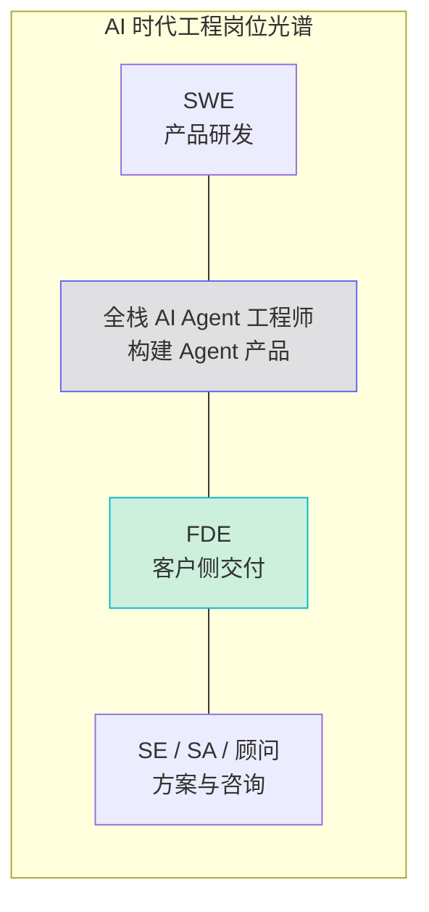

# AI 岗位知识库：FDE 与全栈 AI Agent

> 2025–2026 年，AI 应用爆发带来了两类肉眼可见在升温的工程岗位：**FDE（Forward Deployed Engineer，前线部署工程师）** 和 **全栈 AI Agent 工程师**。这个知识库把两类岗位的「角色认知、知识体系、工程方法、面试准备」整理成一条可以照着走的路径。
>
> FDE 部分主要整理自开源知识库 [VanGong1999/FDE](https://github.com/VanGong1999/FDE)（MIT License，在线阅读：<https://vangong1999.github.io/FDE/>），该库综合了 Exponent、The Forward Deployed、The Pragmatic Engineer 等公开资料；AI Agent 部分结合业界共识与站内文章 [从零开始构建智能体](/blogs/2026/从零开始构建智能体.md)、[AI Agent Data Analyst 课程](/blogs/2026/AI-Agent-Data-Analyzer/)。感谢原作者的开源贡献。

---

## 1. 两类岗位，一句话分清

| 岗位 | 一句话定义 | 主战场 | 成功标准 |
|------|-----------|--------|----------|
| **FDE** | 人在客户现场（或深度嵌入客户团队），用工程手段把产品/模型能力变成**可运行业务结果** | 客户环境 + 产品反馈 | 客户结果（采用、时效、准确率、成本） |
| **全栈 AI Agent 工程师** | 用全栈工程能力**构建、集成、交付 AI Agent 产品**的人：前端流式 UI、后端编排、RAG、工具调用、评测、部署一条龙 | 产品代码库 + AI 基础设施 | 产品指标 + Agent 质量指标 |

两者高度互补，甚至经常是同一拨人：

- FDE 强调「**在别人的约束里交付**」——数据主权、合规、遗留系统、组织阻力都是问题的一部分；
- 全栈 AI Agent 工程师强调「**在自家产品里构建**」——把 Agent 能力做成可复用的产品功能。

模型越强，「写代码」越便宜，两个岗位的共同瓶颈都变成：**该写什么、在约束里写到能用、并能证明有效**。这就是为什么这两个岗位在模型能力狂飙的时代反而更火。



---

## 2. 知识库目录

### Part A · FDE 前线部署工程师

| 文章 | 内容 | 适合 |
|------|------|------|
| [01 · 什么是 FDE](./fde-01-what-is-fde.md) | 定义与起源、做什么/不做什么、FDE vs SWE vs SE vs SA、为什么模型越强 FDE 越重要 | 建立角色认知 |
| [02 · 交付方法论](./fde-02-delivery.md) | Discover → Design → Deploy → Review 四阶段、POC 到生产、反模式清单 | 交付实战 |
| [03 · AI 落地技术栈](./fde-03-ai-landing.md) | RAG 实战、Agent 与工具调用、Eval 与 Guardrails、架构决策树、生产化清单 | 技术深水区 |
| [04 · 面试通关](./fde-04-interview.md) | 面试全景、公司对照（Palantir/OpenAI/Anthropic/Google）、Decomposition、C.A.S.E. 框架、STAR | 备面 |

### Part B · 全栈 AI Agent 工程师

| 文章 | 内容 | 适合 |
|------|------|------|
| [01 · 岗位画像与技能地图](./agent-01-role.md) | 岗位定义、能力四层模型、与相邻岗位边界、如何积累作品集 | 建立角色认知 |
| [02 · 核心技术栈](./agent-02-core.md) | LLM API、Prompt/上下文工程、RAG、工具调用、MCP、多 Agent 编排 | 技术主干 |
| [03 · 从 Demo 到生产](./agent-03-engineering.md) | Eval、可观测性、成本与延迟、安全护栏、流式前端、部署形态 | 工程化 |
| [04 · 面试高频题](./agent-04-interview.md) | LLM/RAG/Agent/工程化四类高频题 + 系统设计题 + 行为面 | 备面 |

---

## 3. 学习路径建议

### 路径一：有全栈/后端经验，想转 FDE（约 4 周）

```text
Week 1  角色认知    → Part A-01，自评是否适合
Week 2  交付方法论  → Part A-02，把 DDDR 套在自己的旧项目上
Week 3  AI 落地     → Part A-03 + Part B-02，动手搭一个带 Eval 的 RAG
Week 4  面试准备    → Part A-04，Decomposition 口述练习 + 简历改写
```

### 路径二：想成为全栈 AI Agent 工程师（约 4–6 周）

```text
Week 1  Agent 原理   → 站内《从零开始构建智能体》+ Part B-01
Week 2  核心技术栈   → Part B-02，跑通 ReAct 最小闭环 + 一个 RAG
Week 3  工程化       → Part B-03，给 Demo 补 Eval、日志、成本控制
Week 4–5 项目作品    → 做一个真实可用的 Agent（参考 Part B-01 §5）
Week 6  面试准备     → Part B-04
```

### 路径三：时间紧，直接备面

- 先读 [FDE 面试通关](./fde-04-interview.md) 和 [Agent 面试高频题](./agent-04-interview.md)，确定目标题型；
- 再回读对应技术文章补缺口；
- 全程录音练习口述——FDE 面试的 Decomposition 和 Agent 面试的系统设计，都考「边想边说清楚」。

---

## 4. 贯穿所有文章的五个共识

1. **没有 Eval 就不谈「效果好」**。没有金标集（golden set），任何准确率都是感觉。
2. **客户/用户要的是结果，不是 Demo**。采用率、正确率、省下的时间才是验收标准。
3. **不确定性要设计进系统**：模型会错，系统必须可测、可降级、可审计。
4. **窄而真的切片 > 大而全的方案**：先在一个可验证的范围里跑到生产。
5. **成本与延迟是产品参数**：token 费用和响应速度直接决定 ROI，不是「优化细节」。

---

## 5. 延伸资源

- [VanGong1999/FDE](https://github.com/VanGong1999/FDE)：本库 FDE 内容的主要参考，含 171 个概念课程、题库与模板（MIT License）
- [Exponent FDE Interview Guide 2026](https://www.tryexponent.com/blog/forward-deployed-engineer-interview-the-definitive-2026-guide-fde)
- [The Forward Deployed](https://www.theforwarddeployed.io/)：FDE 面试与角色分析
- [OWASP LLM 应用风险 Top 10](https://genai.owasp.org/llm-top-10/)
- 站内：[从零开始构建智能体](/blogs/2026/从零开始构建智能体.md) · [AI Agent Data Analyst 课程](/blogs/2026/AI-Agent-Data-Analyzer/) · [AI 产品目录](/ai-directory.md)
