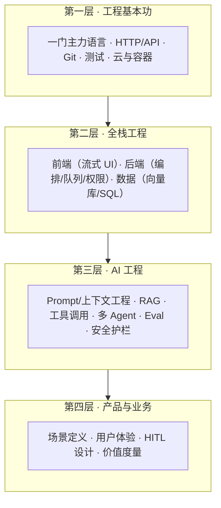

# 全栈 AI Agent 工程师：岗位画像与技能地图

> 本文是 [AI 岗位知识库](./README.md) Part B 的第一篇，结合业界公开招聘信息与站内文章 [从零开始构建智能体](/blogs/2026/从零开始构建智能体.md) 整理。

---

## 1. 这个岗位是什么

**全栈 AI Agent 工程师**：用全栈工程能力构建、集成、交付 AI Agent 产品的人。一头连着模型能力（prompt、RAG、工具调用、评测），一头连着传统工程（前端、后端、数据库、部署），负责把「模型能干的事」变成「用户可用、可靠、可运营的产品功能」。

它火起来的原因很直接：

1. **应用层爆发**：模型能力越过可用门槛后，竞争从「训模型」转向「用好模型」，应用层岗位激增
2. **技能断层**：传统全栈工程师不熟 LLM 工程的不确定性管理；ML 工程师往往不做产品级前后端。两栖人才稀缺
3. **Agent 产品形态确立**：Copilot、编码智能体、客服 Agent、数据分析 Agent 等形态被验证，企业愿意为「能干活的结果」付费

一句话对比 FDE：**全栈 AI Agent 工程师主要在自家产品里构建 Agent 能力；FDE 主要在客户约束里交付结果**。两者共享 80% 的 AI 工程知识，差异在主战场与成功标准（见 [知识库总览 §1](./README.md)）。

---

## 2. 能力四层模型

- **第一层**是入场券，没有捷径
- **第二层**是「全栈」二字的来源：Agent 产品的界面要处理流式输出与中断，后端要做编排、幂等与权限，数据层要同时会 SQL 和向量库
- **第三层**是岗位的核心增量，对应 [核心技术栈](./agent-02-core.md) 与 [从 Demo 到生产](./agent-03-engineering.md)
- **第四层**区分「会用框架的人」和「能交付产品的人」：定义对场景、设计好人机协作、证明价值

---

## 3. 与相邻岗位的边界

| 维度 | 全栈 AI Agent 工程师 | ML/算法工程师 | 后端工程师 | FDE |
|------|---------------------|---------------|------------|-----|
| 主交付物 | Agent 产品功能 | 模型/策略 | 服务与 API | 客户现场可运行系统 |
| 模型工作 | 用 API/开源模型 | 训练/微调模型 | 基本不碰 | 用模型解决问题 |
| 前端 | 要做（流式 UI 是日常） | 一般不做 | 看团队 | 少量（Demo/工具） |
| 成功标准 | 产品指标 + Agent 质量 | 离线指标/模型效果 | 稳定性/性能 | 客户业务结果 |
| 出差驻场 | 少 | 少 | 少 | 常见 |

岗位在招聘市场上的常见头衔：AI Engineer、Agent Engineer、Applied AI Engineer、Full-stack Engineer (AI)、LLM Application Engineer。按 JD 里的职责判断成色：**是否要求生产交付、是否有 Eval 与安全要求、前后端与模型侧的占比**。

---

## 4. 日常真实在做的事

一周的典型切片（综合多个公开 JD 与从业者分享）：

| 工作 | 占比量级 |
|------|----------|
| Agent/RAG 功能开发（prompt、检索、工具、编排） | 30–40% |
| 前后端工程（流式 UI、API、权限、队列） | 25–35% |
| Eval 与质量迭代（评测集、失败分析、回归） | 15–20% |
| 可观测性与成本治理（trace、路由、缓存） | 10% |
| 跨团队协作与文档 | 余下 |

一个反直觉的点：**写 prompt 的时间远小于建评测和看失败案例的时间**。成熟的团队里，Eval 基建是第一优先级，不是「有空再做」。

---

## 5. 如何积累作品集证据

招聘方看的是「你能否把 Agent 做到可用」，作品集比证书有说服力得多。三个由小到大的项目模板：

1. **带引用的知识问答**：给一份真实文档集做 RAG，强制引用来源、有拒答、有一个 50 题的评测集和失败分析文档。考察点全覆盖：解析、分块、检索、评测
2. **有界自主的 Agent**：如「GitHub issue 分诊 Agent」——读 issue、查代码、打标签、建议负责人，但**只建议不执行**，高危动作走人工确认。考察工具调用、有界自主、HITL
3. **端到端产品切片**：前端流式 UI + 后端编排 + Eval 回归 + 成本看板，部署到云端可公开访问。考察全栈 + 工程化闭环

每个项目都写一份简短的 README：问题定义、架构决策与取舍、评测方法与结果、已知局限。**展示判断力，而不只是展示代码**。

站内参考：[数据分析 AI Agent 课程](/blogs/2026/%E6%95%B0%E6%8D%AE%E5%88%86%E6%9E%90%20AI%20Agent/1.%20%E5%AF%BC%E8%AE%BA_%20Al%20Agent%20%E4%B8%8E%E7%8E%B0%E4%BB%A3%E5%8C%96%E6%95%B0%E6%8D%AE%E5%88%86%E6%9E%90%E6%9E%B6%E6%9E%84/1.1.%20%E7%90%86%E8%A7%A3AI%20Agent%E4%B8%8E%E8%87%AA%E5%8A%A8%E5%8C%96%E6%95%B0%E6%8D%AE%E5%88%86%E6%9E%90.html)（从基础到部署的完整实战路线）、[RAG 实战](./agent-05-rag.md)。

---

## 6. 成长路径

| 阶段 | 目标 | 证据 |
|------|------|------|
| 入门 | 跑通 Agent 最小闭环（ReAct + 工具调用） | 一个可运行的 Demo + 复盘文章 |
| 胜任 | 独立交付带 Eval 的 RAG/Agent 功能 | 上线功能 + 评测报告 |
| 资深 | 设计 Agent 系统架构，定质量与安全标准 | 架构文档 + 事故/成本治理案例 |
| 专家 | 定义产品形态，跨团队推动 Agent 平台化 | 被多个场景复用的平台/组件 |

---

## 7. 读完马上做

- [ ] 按 §2 四层模型给自己打分，找出最薄的一层
- [ ] 从 §5 选一个项目模板，写下问题定义
- [ ] 浏览 3 个目标公司的 AI 工程 JD，记录反复出现的关键词

下一篇：[全栈 AI Agent 核心技术栈](./agent-02-core.md)
