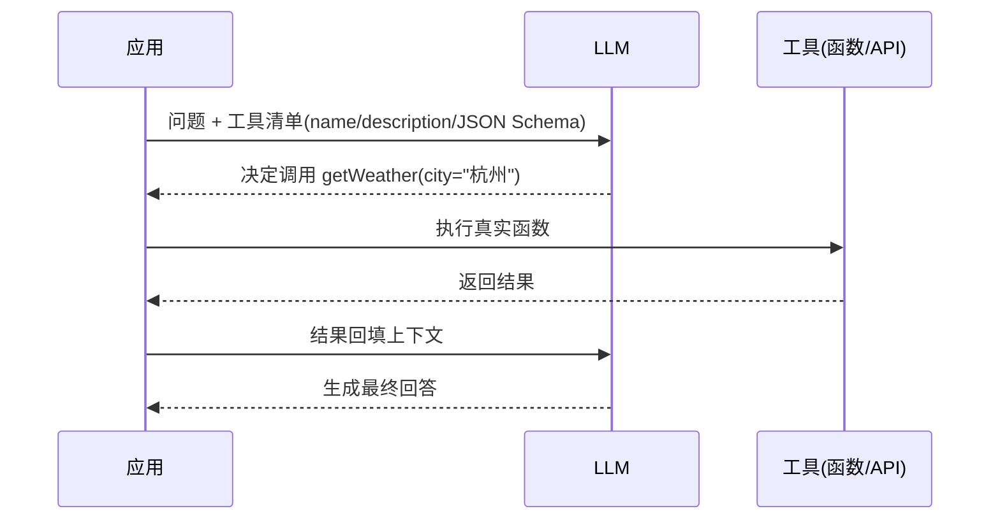
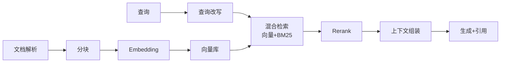
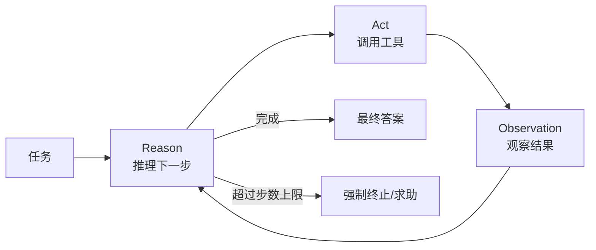

# 全栈 AI Agent 核心技术栈

> 本文是 [AI 岗位知识库](./README.md) Part B 的第二篇。原理与动手向深度内容见站内 [从零开始构建智能体](/blogs/2026/从零开始构建智能体.md)。上一篇：[岗位画像与技能地图](./agent-01-role.md)。

---

## 1. LLM API 基础：必须吃透的六个概念

| 概念 | 要点 | 工程含义 |
|------|------|----------|
| **Token** | 模型的输入输出单位，约等于 0.5–0.75 个英文单词 / 0.5–1 个汉字（随分词器浮动） | 计费、限流、上下文预算都按 token 算 |
| **上下文窗口** | 模型一次能「看到」的最大 token 数 | 窗口 ≠ 记忆：塞太满会稀释注意力、涨成本；「大海捞针」能力在中长段表现会衰减 |
| **Temperature / Top-p** | 控制采样随机性 | 抽取/分类/工具调用调低（趋近确定），创意生成调高 |
| **流式输出（Streaming）** | token 逐段返回（SSE） | 前端体验的分水岭；也是超时管理的关键 |
| **结构化输出** | JSON Schema / 函数签名约束输出 | 下游程序能可靠解析的前提；要做 schema 校验与失败重试 |
| **System Prompt** | 设定角色、规则、边界 | 是护栏的第一道防线，但**不是**安全边界——用户不可见内容也可能被诱导泄漏 |

**一份钱的两种算法**：按输入/输出 token 计价（API），或自建推理按 GPU 时间计价（开源模型 + vLLM 等）。选型时把「单任务 token 量 × 单价 × 日调用量」算成月度成本表，再谈技术方案。

---

## 2. Prompt 工程与上下文工程

### 2.1 Prompt 工程的稳定招法

1. **角色 + 任务 + 约束 + 输出格式**四段式，规则写成可判定的条目
2. **Few-shot**：给 2–5 个覆盖边界情况的示例，比长篇描述有效
3. **思维链（CoT）**：让模型先列步骤再作答，对推理类任务有效；注意先推理后结论（结论在前会「锚定」后续推理）
4. **拆任务**：一个 prompt 只做一件事，用代码编排多次调用，比万能大 prompt 可控
5. **迭代靠评测**：每次改动跑评测集——「感觉变好了」不算数

### 2.2 上下文工程（Context Engineering）

Agent 时代 prompt 工程升级为上下文工程：**在有限窗口里，为当前这一步装入最相关的信息**。

- **检索进上下文**：RAG 的本质是把「记住」换成「现查」
- **工具结果管理**：大结果落盘存引用，上下文里留摘要 + 指针
- **历史压缩**：长对话做摘要滚动，关键事实抽成结构化记忆
- **隔离**：子 Agent 用干净上下文处理子任务，只把结论带回主线程（同时避免「上下文腐烂」——旧错误信息持续污染决策）

### 2.3 失败模式清单

指令被忽略、幻觉、上下文超限截断、格式漂移、多轮累积偏差。对策：约束解码/schema 校验、关键信息重复强调、超限预检、每步输出校验。

---

## 3. 工具调用（Function Calling）

工具调用是 Agent 与 RAG 的分界线：**模型不仅能「说」，还能「做」**。

工程要点：

- **工具描述是给模型看的接口文档**：写清何时用、参数含义、失败时的表现；模糊的描述是调用错误的头号原因
- **参数校验在应用层**：schema 校验 + 白名单 + 越权检查，绝不直接信任模型生成的参数去执行写操作
- **错误回喂**：工具失败把错误信息返回给模型，让它重试、换路或求助，而不是直接崩
- **只读优先**：新场景先给只读工具，稳定后再逐步放开写权限

---

## 4. RAG：检索增强生成

企业场景第一大利器，完整实战见 [FDE 的 AI 落地技术栈 §2](./fde-03-ai-landing.md)。全栈工程师视角的要点：

- **Embedding**：把文本映射为向量，语义相近则距离近。选型看语言支持、维度、效果榜单；**换 embedding 模型 = 全库重建索引**，要提前规划版本管理
- **向量库**：PGVector（够用、好运维）、专用向量库（Milvus、Qdrant、Pinecone 等）、或 ES/Redis 的向量插件；选型先看数据规模与过滤需求，多数场景千万级以内 PGVector 足够
- **混合检索是默认起点**：向量管语义，BM25 管关键词/编号/专有名词，取长补短
- **重排（Rerank）**：粗召回 top-50 → cross-encoder 精排 top-5，性价比最高的质量提升手段之一
- **权限过滤在检索层**：元数据 ACL + 以用户身份过滤，见 [权限感知 RAG](./fde-03-ai-landing.md)

进阶方向：查询改写与 HyDE、GraphRAG（知识图谱辅助检索）、Contextual Retrieval（入库时为每个块生成上下文前缀）。

---

## 5. Agent 架构：循环、记忆与边界

### 5.1 Agent 循环（ReAct 为骨架）

Agent = **LLM（大脑）+ 工具（手脚）+ 记忆（状态）+ 循环控制（边界）**。循环控制常被新手忽略，却是生产与 Demo 的分界：最大步数、单步超时、预算上限、危险动作熔断。

### 5.2 记忆分层

| 层 | 载体 | 例子 |
|----|------|------|
| 工作记忆 | 当前上下文窗口 | 本轮对话 + 工具结果 |
| 情景记忆 | 会话历史存储 | 跨轮对话记录、摘要滚动 |
| 语义记忆 | 向量库/结构化存储 | 用户偏好、事实卡 |
| 程序记忆 | Prompt/技能库 | 可复用的 SOP、技能描述 |

### 5.3 Agent vs 工作流 vs 单次调用

| | 单次调用 | 工作流（代码编排） | Agent（模型自主规划） |
|--|---------|-------------------|----------------------|
| 路径 | 固定 | 预定义分支 | 运行时决定 |
| 延迟/成本 | 低 | 中 | 高 |
| 可控性 | 高 | 高 | 中，需要护栏 |
| 适用 | 翻译/摘要/分类 | 固定 SOP 自动化 | 开放任务、需组合能力 |

**默认从左往右选**，能用左边的不用右边的。

### 5.4 多 Agent 编排

先证明单 Agent 不够再上多 Agent。常见拓扑：

- **主从式**：orchestrator 拆解任务，worker 各司其职，汇总产出（最常用）
- **流水线式**：按阶段接力（如：检索 → 起草 → 审校）
- **辩论/评审式**：多个 Agent 互查，提升可靠性（成本高）

配套协议：**MCP**（统一模型↔工具/数据源连接，Anthropic 开源，生态成长最快）、**A2A**（跨 Agent 互操作方向）。

### 5.5 框架怎么选

框架解决的是编排样板代码，**不解决质量**——质量来自评测与迭代：

- **LangChain / LangGraph**：生态最大；LangGraph 以图状态机表达 Agent 流程，可控性好
- **OpenAI / Anthropic 官方 SDK**：直接、透明，适合学习原理与轻量场景；两家都内置工具调用与结构化输出
- **Vercel AI SDK**：前端流式 UI 的最快路径（React/Next 生态）
- **自研轻编排**：Agent 循环本身 ~100 行代码，很多成熟团队最终收敛到自研薄层 + 直接调 API

---

## 6. 读完马上做

- [ ] 用官方 SDK 写一个最小工具调用：让模型查「天气」（mock 函数）并回答
- [ ] 把同一个任务分别用单次调用、工作流、Agent 三种方式实现，比较成本与可靠性
- [ ] 给你的 RAG 加上混合检索与 rerank，跑前后对比评测

下一篇：[从 Demo 到生产：Agent 工程化](./agent-03-engineering.md)
