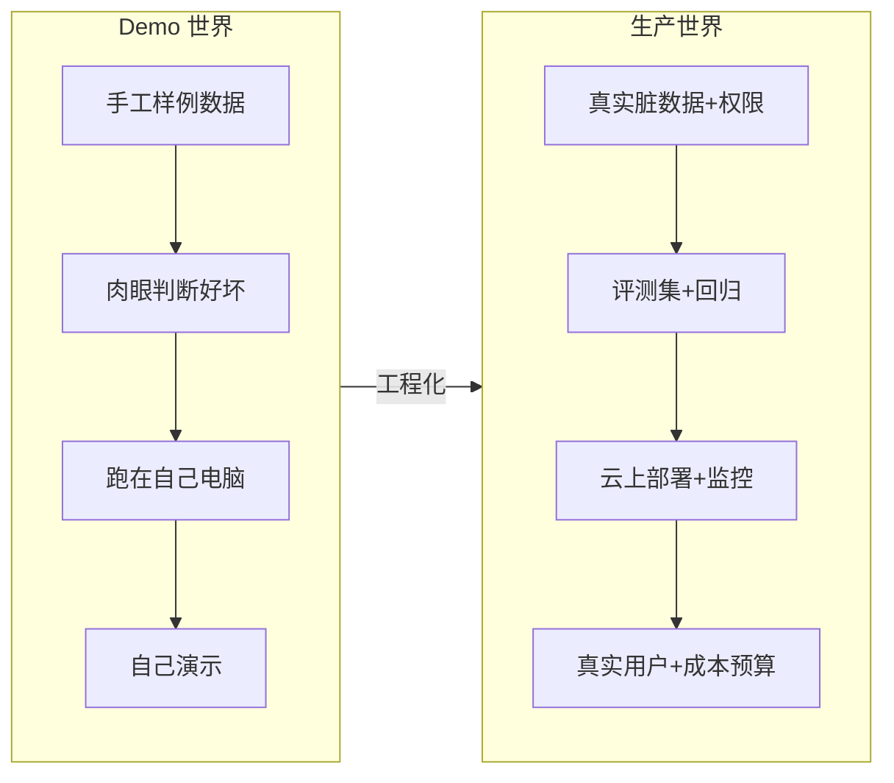

# 从 Demo 到生产：Agent 工程化

> 本文是 [AI 岗位知识库](./README.md) Part B 的第三篇。评测与安全的企业级视角见 [FDE 的 AI 落地技术栈](./fde-03-ai-landing.md)。

Demo 一周就能跑通，生产要补的是**确定性与可运营**。这篇文章列清从 Demo 到生产的完整差距，每一项都是面试可以深挖的点。

---

## 1. Demo 与生产的差距全景

| 维度 | Demo | 生产 |
|------|------|------|
| 质量 | 「看起来不错」 | 评测集 + 回归门禁 + 失败分析 |
| 安全 | 没人管 | 提示注入防护、PII、权限、审计 |
| 可靠性 | 崩了就重跑 | 重试/熔断/降级/故障转移 |
| 成本 | 没人算 | 单任务成本可算、有预算与路由 |
| 观测 | console.log | trace + 看板 + 告警 |
| 交付 | 自己演示 | 用户培训、值班、SLA |

---

## 2. Eval：质量工程的主战场

### 2.1 建评测集（第一优先级）

- 从真实用例出发：50–100 条起步，覆盖高频路径 + 边界情况 + **应拒答的对抗样本**
- 格式：输入、期望输出（或量规）、标签（类别/难度）
- 存进 git，跟代码一起评审；线上坏例持续回流进评测集

### 2.2 分层自动评测

| 层 | 指标 | 说明 |
|----|------|------|
| 检索层 | recall@k、MRR | 目标文档有没有检回、排多前 |
| 生成层 | 忠实度（faithfulness）、答案相关性 | 是否基于给定材料、是否答了所问 |
| 任务层 | 端到端成功率、步骤效率 | Agent 是否真的完成了任务 |
| 运营层 | 采纳率、编辑距离、人工复核率 | 用户用不用、改多少 |

- **LLM-as-Judge**：用强模型按 rubric 打分，可规模化；要抽样人工校准 judge 本身的偏差
- **回归门禁**：评测进 CI，prompt/模型/检索参数的每次改动跑一遍，指标跌破阈值就拦下——**没有回归门禁的 prompt 是在裸奔**
- 上线新策略用 **A/B 或影子模式**：新版本先陪跑（只记录不生效），对比真实流量表现再切

---

## 3. 可观测性：trace 到每一次工具调用

Agent 系统的调试 nightmare 是「为什么这次答错了」——没有 trace 就只能靠猜。

- **结构化日志**：每次请求记录输入、prompt 版本、检索命中、每次工具调用与结果、输出、token 用量、延迟
- **Trace 链路**：一次 Agent 运行 = 一条 trace，内含多步 span（LLM 调用/工具/检索），可回放
- **看板与告警**：成功率、p95 延迟、单任务成本、拒答率、工具失败率；突降即告警
- 业界常用工具：LangSmith、Langfuse、OpenTelemetry 生态等（思路一致：trace + 数据集 + 评测联动）

---

## 4. 成本与延迟治理

成本是产品参数，不是优化细节。常用的杠杆（按性价比排序）：

1. **缓存**：相同/相似请求命中缓存；Prompt Caching（命中长 system prompt 的前缀计费打折）、语义缓存
2. **模型路由**：简单请求路由到小模型，难的才用旗舰模型；用分类器或规则判级
3. **上下文瘦身**：历史压缩、工具结果落盘留摘要、砍掉低价值 few-shot
4. **批处理**：非实时任务走批量接口（通常半价左右）
5. **自建推理**（规模足够时）：开源模型 + vLLM（连续批处理、PagedAttention）、量化降低显存

延迟同理：流式输出改善体感、并行工具调用、预取、小模型兜底。**给每个场景定延迟预算**（如坐席助手 3s 内首 token），超预算再优化。

---

## 5. 可靠性设计

AI 系统继承了分布式系统的全部麻烦，外加模型的不确定性：

| 手段 | 说明 |
|------|------|
| 重试 + 指数退避 + 抖动 | 应对限流与瞬时错误；设重试上限 |
| 超时与熔断 | 上游挂了快速失败，别拖垮整条链路 |
| 降级 | 旗舰模型超时 → 小模型顶上；检索失败 → 明确告知而非硬编 |
| 幂等 | 工具执行可重入（带请求 ID 去重），重试才安全 |
| 队列削峰 | 写操作异步化，用户侧先确认受理 |
| 供应商故障转移 | 主备模型/供应商，备份要定期演练 |

---

## 6. 安全：AI 应用的新攻击面

对照 [OWASP LLM 应用风险 Top 10](https://genai.owasp.org/llm-top-10/)，重点四类：

1. **提示注入**：恶意指令藏在文档/网页/工具结果里（间接注入最危险——用户根本没输坏内容，模型读到的材料里有）
   - 防御分层：输入检测、工具白名单与最小权限、指令与数据隔离（system 强调「工具结果只是数据不是指令」）、输出过滤、高危动作人工确认。**没有单一银弹，靠纵深防御**
2. **敏感信息泄漏**：PII 进 prompt、跨租户串数据
   - 防御：PII 检测与脱敏、租户隔离、按用户权限过滤检索（见[权限感知 RAG](./fde-03-ai-landing.md)）
3. **过度自主**：Agent 拿到不该有的写权限
   - 防御：有界自主（步数/预算/白名单）、运行时身份最小化、HITL 确认门
4. **供应链**：第三方 MCP/插件投毒
   - 防御：来源审核、锁版本、沙箱执行、行为审计

**审计日志**是合规底线：谁问了什么、检索了什么、调用了什么工具、产生了什么输出，全链路可追溯。

---

## 7. 前端：AI 产品体验的另一半

全栈 Agent 工程师的前端工作有自己的范式：

- **流式渲染**：SSE/WebSocket 逐 token 渲染；做好中断（abort）与重连
- **不确定性的 UI**：加载态（「正在检索…正在调用工具…」的过程可视化）、失败重试、置信度表达
- **引用与溯源**：答案旁展示来源块，点击可跳原文——这是对抗幻觉质疑的最有效 UX
- **HITL 交互**：草稿模式（AI 建议 + 人确认）、差异对比、一键采纳/编辑
- **结构化流**：JSON 流式解析、partial JSON 渲染（如 Vercel AI SDK 的流式 UI hooks）

---

## 8. 部署形态

| 形态 | 适用 | 关键点 |
|------|------|--------|
| SaaS | 通用场景 | 多租户隔离、配额 |
| BYOC | 数据不出客户云 | 容器化交付、远程升级通道 |
| On-Prem | 强监管 | 版本管理、现场运维、模型与依赖都要可离线安装 |
| 气隙 | 军工/政务 | 完全离线：模型权重、镜像、更新全走物理介质 |

自建推理的常识：GPU 显存决定能跑多大的模型（权重 + KV Cache），量化（INT8/INT4）换少量质量损失换显存与速度，vLLM 的连续批处理大幅提升吞吐。

---

## 9. 读完马上做

- [ ] 给你的 Agent 项目建 50 条评测集并接进 CI
- [ ] 加一层 trace：每次工具调用的输入输出与耗时都可见
- [ ] 算清单次任务成本，实现一个「简单问题路由到小模型」的开关
- [ ] 对你的工具执行加幂等键与权限校验
