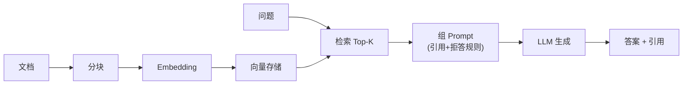

# 实战：从零构建一个「可评测」的 RAG 问答

> 这是 [岗位画像](./agent-01-role.md) 作品集路线的第一个项目实战：给一份真实文档集做**带引用、能拒答、有评测**的知识问答。跑完你就亲手摸过 [核心技术栈](./agent-02-core.md) 里的 RAG 全链路，也是 [FDE AI 落地](./fde-03-ai-landing.md) 的动手版。全文 Node.js，任何 OpenAI 兼容 API 都能跑。

---

## 0. 目标与验收标准

```text
输入：一批 Markdown/PDF 文档（建议先用你自己的笔记）
输出：一个 CLI/网页问答入口
验收：① 答案带引用（来源文档+位置） ② 知识库里没有的问题会拒答
      ③ 有一个 50 题的评测集与基线成绩 ④ 单次问答成本可算
```

架构回顾（每一环都有失败模式，见 [RAG 精要](./fde-03-ai-landing.md)）：



---

## 1. 环境准备

```sh
mkdir rag-demo && cd rag-demo && npm init -y
# 任选一家 OpenAI 兼容服务，配好 base url 与 key
export LLM_BASE_URL="https://api.openai.com/v1"
export LLM_API_KEY="sk-..."
export EMBED_MODEL="text-embedding-3-small"
export CHAT_MODEL="gpt-4o-mini"
```

```js
// llm.js —— 全项目唯一的服务封装
const base = process.env.LLM_BASE_URL
const key = process.env.LLM_API_KEY

async function embed(texts) {
  const res = await fetch(`${base}/embeddings`, {
    method: 'POST',
    headers: { 'Content-Type': 'application/json', Authorization: `Bearer ${key}` },
    body: JSON.stringify({ model: process.env.EMBED_MODEL, input: texts }),
  })
  if (!res.ok) throw new Error(`embed ${res.status}: ${await res.text()}`)
  const { data } = await res.json()
  return data.map((d) => d.embedding)
}

async function chat(messages, { temperature = 0.2 } = {}) {
  const res = await fetch(`${base}/chat/completions`, {
    method: 'POST',
    headers: { 'Content-Type': 'application/json', Authorization: `Bearer ${key}` },
    body: JSON.stringify({ model: process.env.CHAT_MODEL, messages, temperature }),
  })
  if (!res.ok) throw new Error(`chat ${res.status}: ${await res.text()}`)
  const { choices } = await res.json()
  return choices[0].message.content
}

module.exports = { embed, chat }
```

---

## 2. 分块：按结构切，不要无脑按长度

```js
// chunk.js —— 按标题层级切块 + 长块二次切分
function chunkMarkdown(md, { maxLen = 800, minLen = 100 } = {}) {
  const blocks = []
  const sections = md.split(/(?=^#{1,4} )/m)   // 按 1-4 级标题切
  for (const sec of sections) {
    if (!sec.trim()) continue
    if (sec.length <= maxLen) { blocks.push(sec.trim()); continue }
    // 长段落按空行再切，滑窗重叠 ~100 字防语义截断
    const paras = sec.split(/\n\s*\n/)
    let buf = ''
    for (const p of paras) {
      if ((buf + '\n\n' + p).length > maxLen && buf) {
        blocks.push(buf.trim())
        buf = buf.slice(-minLen) + '\n\n' + p   // 携带上一段尾部做重叠
      } else buf += (buf ? '\n\n' : '') + p
    }
    if (buf.trim()) blocks.push(buf.trim())
  }
  return blocks.map((text, i) => ({ id: i, text }))
}
```

**为什么不用固定 500 字硬切**：标题/列表被切断后，检索命中了也答不全。规则优先——先按文档结构，长度只做兜底。（表格、代码块的切法是进阶题，先跳过，记录到失败案例里。）

---

## 3. 索引：Embedding + 相似度（demo 用内存，生产换 pgvector）

```js
// index.js
const { embed } = require('./llm')

async function buildIndex(chunks) {
  // 注意：embedding 接口有批量上限，500 条左右一批
  const vectors = []
  for (let i = 0; i < chunks.length; i += 100) {
    const batch = chunks.slice(i, i + 100).map((c) => c.text)
    const embs = await embed(batch)
    vectors.push(...embs)
    console.log(`embedded ${Math.min(i + 100, chunks.length)}/${chunks.length}`)
  }
  return chunks.map((c, i) => ({ ...c, vector: vectors[i] }))
}

function cosine(a, b) {
  let dot = 0, na = 0, nb = 0
  for (let i = 0; i < a.length; i++) {
    dot += a[i] * b[i]; na += a[i] * a[i]; nb += b[i] * b[i]
  }
  return dot / (Math.sqrt(na) * Math.sqrt(nb))
}

module.exports = { buildIndex, cosine }
```

> 生产替换路线：内存数组 → [pgvector](https://github.com/pgvector/pgvector)（SQL + 元数据过滤一步到位，[选型理由](./agent-02-core.md)）→ 专用向量库。**换 embedding 模型 = 全量重建索引**，把模型名和版本存进元数据。

---

## 4. 检索：向量 + 关键词混合（RRF 融合）

纯向量检索对「专有名词/编号」不灵，加一路 BM25 式关键词打分再融合：

```js
// retrieve.js —— 简化混合检索：向量分 + 关键词分，RRF 融合
function keywordScore(query, chunks) {
  const terms = query.toLowerCase().split(/\s+/).filter((t) => t.length > 1)
  return chunks.map((c) => {
    const text = c.text.toLowerCase()
    let hit = 0
    for (const t of terms) hit += text.split(t).length - 1
    return hit
  })
}

function rrfFuse(rankedList, k = 60) {
  // rankedList: [按向量分排序的下标数组, 按关键词分排序的下标数组]
  const score = new Map()
  for (const ranks of rankedList)
    ranks.forEach((chunkIdx, rank) => {
      score.set(chunkIdx, (score.get(chunkIdx) ?? 0) + 1 / (k + rank + 1))
    })
  return [...score.entries()].sort((a, b) => b[1] - a[1]).map(([idx]) => idx)
}

async function retrieve(query, chunks, topK = 5) {
  const [qVec] = await embed([query])
  const byVector = chunks
    .map((c, i) => ({ i, s: cosine(qVec, c.vector) }))
    .sort((a, b) => b.s - a.s).map((x) => x.i)
  const byKeyword = keywordScore(query, chunks)
    .map((s, i) => ({ i, s })).sort((a, b) => b.s - a.s).map((x) => x.i)
  const fused = rrfFuse([byVector, byKeyword])
  return { chunks: fused.slice(0, topK).map((i) => chunks[i]), vectorTop: byVector.slice(0, topK) }
}
```

进阶替换项（跑通基线后再上）：真正的 BM25 库、[Rerank 精排](./fde-03-ai-landing.md)、查询改写。

---

## 5. 生成：强制引用 + 明确拒答

```js
// answer.js
const SYSTEM = `你是严谨的知识库助手。只依据「参考资料」回答：
1. 每个关键结论后标注 [1][2] 编号引用对应资料
2. 资料不足以回答时，只回复「资料库中没有相关内容」，不要编造
3. 用中文，简洁分点`

async function answer(query, chunks, chat) {
  const context = chunks
    .map((c, i) => `[${i + 1}] (来源: ${c.source})\n${c.text}`)
    .join('\n---\n')
  const reply = await chat([
    { role: 'system', content: SYSTEM },
    { role: 'user', content: `参考资料:\n${context}\n\n问题: ${query}` },
  ])
  return reply
}
```

`c.source` 在分块时就带上（文件名 + 标题），这就是引用溯源的全部成本——**一块元数据换用户信任**。

---

## 6. 评测：50 题定基线（没有这步都是玄学）

```js
// eval.js —— golden set: [{q, a或者关键词[], shouldRefuse?}]
const goldens = require('./golden.json')

async function runEval(pipeline) {
  let hit = 0, refuseOk = 0
  for (const g of goldens) {
    const { chunks } = await pipeline(g.q)
    if (g.shouldRefuse) {
      const refused = /没有相关内容/.test(await answer(g.q, chunks, chat))
      refuseOk += refused ? 1 : 0
      continue
    }
    const retrieved = chunks.some((c) => g.keywords.every((kw) => c.text.includes(kw)))
    hit += retrieved ? 1 : 0              // 先测检索命中率（recall@5）
  }
  console.log(`检索命中: ${hit}/${goldens.filter((g) => !g.shouldRefuse).length}`)
  console.log(`正确拒答: ${refuseOk}/${goldens.filter((g) => g.shouldRefuse).length}`)
}
```

评测集构成（50 题分配）：30 题知识库内（覆盖高频 + 边界表述）+ 10 题库外**应拒答** + 10 题换种问法（同义改写）。跑出基线后每次改动（分块参数/加 rerank/换模型）重跑对比——这正是 [Eval 双环](./fde-03-ai-landing.md)的最小实践。

---

## 7. 上线前把这两篇过一遍

- 工程化差距（评测进 CI、trace、成本、护栏）：[从 Demo 到生产](./agent-03-engineering.md)
- 前端接入（流式渲染 + 引用卡片 UI）：[AI 产品前端](/blogs/frontend/ai-frontend.html)

## 8. 作品集包装（回到求职目标）

把这个项目写成一页 README：**问题定义 → 架构决策与取舍 → 评测方法与前后对比（如「混合检索使命中率 62%→81%」）→ 已知局限**。这就是 [岗位画像 §5](./agent-01-role.md) 说的「展示判断力，而不只是代码」，面试时它同时喂饱 [Agent 面试](./agent-04-interview.md) 的 RAG 题与系统设计题。

> 延伸：[RAG 精要与权限感知](./fde-03-ai-landing.md) · [核心技术栈](./agent-02-core.md) · [从 Demo 到生产](./agent-03-engineering.md)
