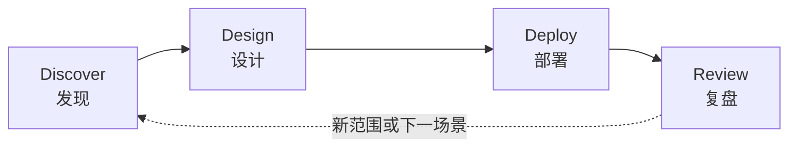

# FDE 交付方法论：Discover → Design → Deploy → Review

> 本文整理自开源知识库 [VanGong1999/FDE](https://github.com/VanGong1999/FDE)（MIT License）的「交付方法论」部分。上一篇：[FDE 角色认知](./fde-01-what-is-fde.md)。

DDDR 是 FDE 现场工作的**主骨架**。目标：能说清每个阶段的**入口、动作、出口、产物**，并避免阶段跳跃——最常见的翻车是 Discover 没做完就 Deploy。

---

## 1. 总览

| 阶段 | 一句话 | 核心问题 |
|------|--------|----------|
| Discover | 弄清真相 | 谁痛？被什么指标衡量？约束是什么？ |
| Design | 变成可执行计划 | 做什么、不做什么、如何证明成功？ |
| Deploy | 在约束内实现并上线 | 权限、数据、集成、培训、观测齐了吗？ |
| Review | 学习与杠杆 | 有效吗？为何？怎样复用/反馈产品？ |

> AI 项目特别容易在 Deploy 前假装 Design 完成——**没有 Eval 计划就不算 Design 完成**。

---

## 2. Discover（发现）

### 入口条件

- 有赞助人（sponsor）或至少一名业务 champion
- 能接触到真实用户或一线操作者（不是只有 IT 转述）

### 关键动作

1. **干系人地图**：出资、使用、否决（安全/法务/IT）、维护四类人
2. **现状工作流**：用时、工具、例外、失败代价
3. **数据与权限现实**：在哪、能否出域、质量、新鲜度
4. **成功的可观测定义**：若只能选一个指标，是什么？
5. **非目标**：明确「这次不解决什么」

### 出口检查

- [ ] 能用一句话说清「为谁、解决什么可测问题」
- [ ] 知道最大技术/组织风险各一条
- [ ] 赞助人认可问题陈述（哪怕方案未定）

产物：**发现纪要**（问题陈述、用户、指标、约束、风险、开放问题）。

---

## 3. Design（设计）

### 入口条件

- Discover 出口检查通过
- 已对真实数据做过抽样

### 关键动作

1. **方案选项**（至少 2 个）：必须包含「不用 LLM」的选项
2. **架构草图**：数据流、权限、人机回环、失败降级
3. **Eval 设计**：golden set 从哪来、量规是什么
4. **试点切片**：用户群 × 文档/流程子集 × 时间盒
5. **成本与延迟预算**
6. **安全与合规审查清单**

### 出口检查

- [ ] 成功标准可测，且与业务指标挂钩
- [ ] 有明确非目标与时间盒
- [ ] 安全/IT 已看到权限与数据流（至少知情）

产物：**设计一页纸**、POC/Pilot 验收标准（可勾选）、风险登记与缓解。

---

## 4. Deploy（部署）

### 入口条件

- Design 验收标准已书面确认
- 环境、密钥、网络路径已打通，或有明确 blocker 升级

### 关键动作

1. 实现与集成（迭代，但每次迭代可演示）
2. 评测闭环：改 → 跑 eval → 看失败案例
3. 权限、审计、日志、告警
4. 用户培训与 Runbook
5. 分阶段 rollout：**影子模式 → 建议模式 → 自动模式**
6. 交接计划（谁值班？）

### 出口检查

- [ ] 达到书面验收线，或有明确「未达线但不扩大范围」的决策
- [ ] 回滚路径可用
- [ ] 至少一名客户侧人员能独立完成主路径操作

产物：运行系统、观测看板与 on-call 说明、用户启用材料。

---

## 5. Review（复盘）

### 入口条件

- 试点或生产运行过一个约定窗口（如 2–4 周）

### 关键动作

1. 对照指标：量与质（含失败案例抽样）
2. 用户访谈：采用障碍
3. 技术债与成本复盘
4. **模式化**：哪些可进解决方案库？
5. **产品反馈**：平台缺什么？
6. 决定：扩大 / 维持 / 停掉 / 改方向

### 出口检查

- [ ] 有「下一轮 Discover」的输入，或明确结项
- [ ] 知识不独享在你个人笔记本里

---

## 6. 与六阶段工作流的对照

公开资料里也常见六阶段版本，与 DDDR 一一对应，便于面试口述：

| 六阶段 | 对应 DDDR | 核心技能提醒 |
|--------|-----------|--------------|
| Discover | Discover | 商业理解 + 技术判断；客户口述需求常不是瓶颈 |
| Design | Design | 明确做/不做；基础设施、数据、安全、失败模式 |
| Build | Deploy（实现） | RAG、Eval、脏 API 兼容；生产可靠重于 Demo |
| Deploy | Deploy（上线） | 私有化/云、合规、文化阻力 |
| Prove | Review | 把效果换成钱/风险/时间；ROI 是建立信任的关键 |
| Scale | Review → 下一轮 Discover | 复制到相邻部门；监控漂移与成本；模式回流产品 |

---

## 7. 示例：把「智能客服」塞进 DDDR

| 阶段 | 例子 |
|------|------|
| Discover | 真正痛点是「首响」还是「一次解决率」？工单系统能否写回？ |
| Design | 先做「检索知识库 + 坐席助手」而非全自动回复；定义 50 条黄金问答 |
| Deploy | 影子模式建议回复；坐席一键采纳；记录采纳率 |
| Review | 采纳率 35% → 分析拒绝原因；扩大品类或停掉自动发送 |

**保险公司案例**（可当面试 Decomposition 素材）：客户以为理赔慢是「平台问题」→ 发现实为理赔前文档人工审核 → Design 做「读文档 + 对照保单 + 结构化摘要」，**不**自动做理赔决策 → Prove 用「数小时 → 数分钟」与金额叙事。

---

## 8. POC 到生产的四个跨越

POC 与生产系统之间隔着四条沟，FDE 的核心工作就是逐一跨过：

| 沟 | POC 里 | 生产里 |
|----|--------|--------|
| 数据 | 干净的样例集 | 多源、脏、有权限、会漂移 |
| 质量 | 「看起来不错」 | golden set + 回归评测 + 失败分析 |
| 安全 | 没人管 | 提示注入防护、PII 脱敏、审计日志 |
| 运营 | 自己演示 | 用户培训、值班、SLA、成本核算 |

### 常见反模式（踩坑清单）

- **Demo 驱动开发**：为演示效果调 prompt，从未建立可回归的评测集
- **范围蔓延**：客户一句「顺便也帮我……」就答应，不做范围决策记录
- **全自动执念**：明明该 HITL 的场景硬做全自动，一次事故毁掉全部信任
- **指标失焦**：用「答了」衡量，不用「答对且被采纳」衡量
- **知识独享**：方案、坑、模板都存在个人笔记本，无法复用
- **跳过安全/IT**：上线前才发现数据不能出域，项目归零

---

## 9. 阶段节奏

现实中阶段会重叠，但遵守：

- **允许**：Deploy 早期同时补 Discover 细节
- **禁止**：用 Demo 欢呼跳过 Eval；用「先做了再说」跳过安全
- **时间盒**：Discover 1–2 周、窄 Pilot 2–6 周是常见量级（视企业采购与数据就绪度而变）

---

## 10. 读完马上做

- [ ] 默写四阶段出口检查
- [ ] 选一个你过去的项目，标出它实际停在哪一阶段
- [ ] 用六阶段表给同一项目再标一遍，看缺口是否在 Prove / Scale

下一篇：[FDE 的 AI 落地技术栈](./fde-03-ai-landing.md)
