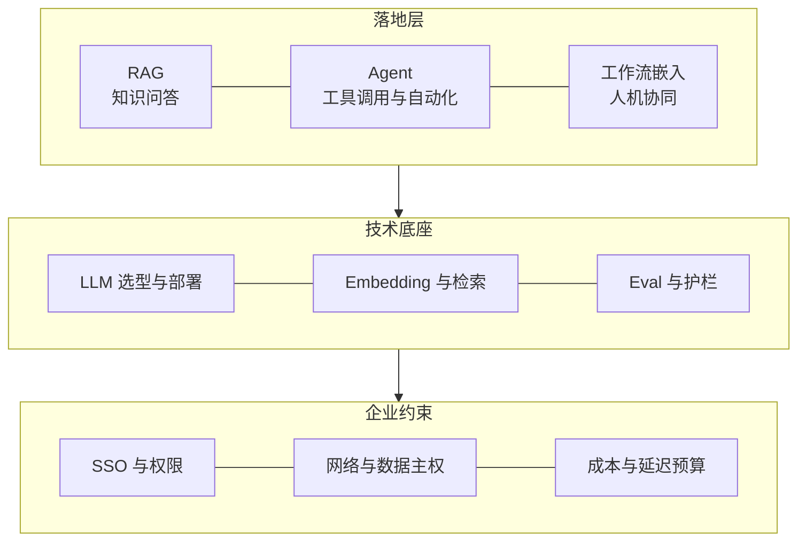
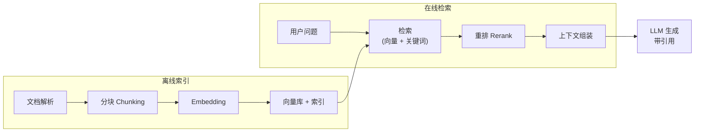
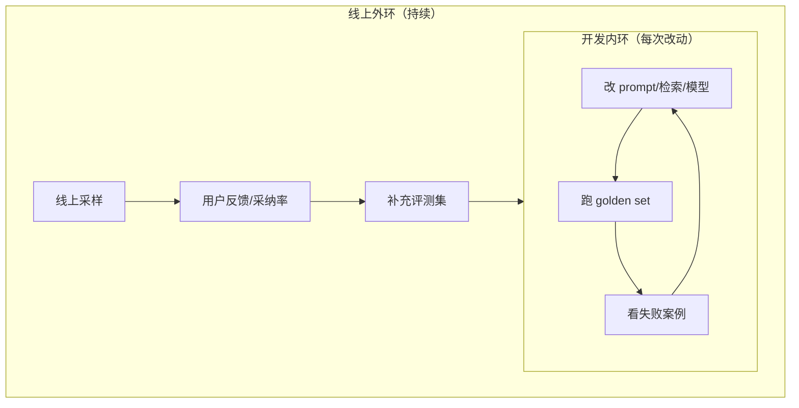

# FDE 的 AI 落地技术栈：RAG、Agent、Eval 与生产化

> 本文整理自开源知识库 [VanGong1999/FDE](https://github.com/VanGong1999/FDE)（MIT License）的「AI 落地」部分，结合业界公开共识。上一篇：[FDE 交付方法论](./fde-02-delivery.md)。
>
> 动手向的 Agent 构建教程见站内 [从零开始构建智能体](/blogs/2026/从零开始构建智能体.md)。

---

## 1. 全景：企业 AI 落地的技术地图



落地层的选型逻辑是：**能用 RAG 解决的不要上 Agent；能用工作流嵌入解决确定性步骤的，不要全自动**。成本、风险、可解释性都随自主性上升。

---

## 2. RAG 实战精要

RAG（Retrieval-Augmented Generation，检索增强生成）是企业落地第一大利器，因为它的本质是「**让模型基于你给的资料说话**」——可控、可溯源、知识可随时更新。

### 2.1 标准流水线



### 2.2 决定成败的五个环节

| 环节 | 关键点 | 常见坑 |
|------|--------|--------|
| **解析** | PDF/表格/扫描件的解析质量决定上限 | 只按页切，表格被打碎 |
| **分块** | 块大小、重叠、保留结构（标题层级） | 块太大稀释语义，太小丢上下文 |
| **检索** | **混合检索**（向量 + BM25 关键词）是业界默认起点，专有名词、编号类查询靠关键词救命 | 只用向量检索，行话/编号查不到 |
| **重排** | 两阶段检索：先粗召回 top-50，再 rerank 取 top-5 | 粗排分数直接进上下文，噪声大 |
| **生成** | 强制引用来源、拒答机制、结构化输出 | 检索不到时模型硬编 |

### 2.3 权限感知 RAG（企业级第一难点)

企业知识库的本质复杂度不在检索，在**权限**：不同人能看不同文档。可落地做法：

1. **索引时**：把文档 ACL（访问控制列表）作为元数据写入索引
2. **检索时**：以当前用户身份过滤——先把权限过滤做在检索层，而不是生成层
3. **审计**：记录「谁在什么时候检索/看到了什么」

没有 ACL 的检索**不能上生产**——答错一份内部薪酬表就是合规事故。

### 2.4 RAG 系统诊断：准确率只有 60% 怎么办

按流水线从前往后排查，每一层看数据说话：

1. **先建评测集**：50–100 条真实问题 + 标准答案（含应拒答的），否则一切优化都是玄学
2. **检索命中了吗**：看 recall@k——目标文档有没有被检回来？没命中 → 治理分块、换 embedding、上混合检索与查询改写
3. **命中的排前面了吗**：看 precision/MRR——命中但排名靠后被截断 → 上 rerank
4. **排在前面但答错**：看生成层——prompt 指令不清、上下文太长稀释、模型能力不足
5. **答对但用户不满意**：可能是问题定义错了 → 回到 Discover

---

## 3. Agent 与工具调用

### 3.1 什么时候该用 Agent，什么时候不该

这是面试和现场都高频的问题。判断标准：

| 场景 | 选择 | 原因 |
|------|------|------|
| 固定步骤的自动化（如每月报表） | **工作流/单次调用** | 路径确定，不需要模型做规划 |
| 开放问题 + 需要组合多种能力 | **Agent** | 步骤无法预先枚举 |
| 检索 + 生成 | **RAG，不需要 Agent** | 大多数「智能问答」RAG 就够 |
| 高风险决策（支付、医疗、法律） | **Agent + HITL** | 自动执行必须有人的确认 |

> 反对盲目上 Agent 的经典理由：延迟更高、成本更高、失败模式更多、难以调试。**能不用就不用，要用就给边界。**

### 3.2 工具调用的工程细节

- **工具描述即接口文档**：模型靠 description 决定何时调用、怎么传参，写得糊调用就错
- **结构化输出**：用 JSON Schema 约束输出并做校验，失败重试要有上限
- **失败处理**：工具报错要把错误信息回给模型（而不是直接崩），让模型换路或求助
- **有界自主**：限制最大步数、限制可写权限、高危操作强制人工确认

### 3.3 多 Agent 编排

模式从简到繁：**单 Agent + 多工具 → 主从式（orchestrator-worker）→ 流水线式（各司其职）**。业界共识：先证明单 Agent 不够，再考虑多 Agent——多 Agent 带来上下文同步、责任划分、错误传播等新问题。

协议层面值得掌握两个：

- **MCP（Model Context Protocol）**：Anthropic 开源的模型上下文协议，统一「模型 ↔ 工具/数据源」的连接方式。Anthropic 的 FDE 招聘明确要求交付生产级 MCP 服务器——**如果目标是 Anthropic，MCP 几乎是入场门槛**
- **A2A（Agent-to-Agent）**：跨 Agent 互操作的开放协议方向

---

## 4. Eval 与 Guardrails：没有评测就没有迭代

### 4.1 双环评测



- **Golden set（金标集）**：真实问题 + 期望答案/行为，**必须包含应拒答的对抗样本**。规模从 50 条起步，持续补充线上坏例
- **自动指标**：检索层用 recall@k / MRR；生成层用忠实度（faithfulness）、答案相关性
- **LLM-as-Judge**：用强模型按量规给弱模型打分，成本低、可规模化；要用 rubric（评分细则）约束 judge，并抽样人工校准
- **线上真值**：采纳率、编辑距离、人工抽检——离线指标好看不等于用户买账

### 4.2 Guardrails 护栏

| 层 | 手段 |
|----|------|
| 输入侧 | 提示注入检测、敏感信息（PII）过滤、话题范围限定 |
| 模型侧 | system prompt 约束、拒答规则、温度/最大 token 控制 |
| 工具侧 | 白名单、参数校验、写权限隔离、高危操作人工确认 |
| 输出侧 | 结构校验、引用核查、敏感词与合规审查 |

安全部分请对照 [OWASP LLM 应用风险 Top 10](https://genai.owasp.org/llm-top-10/)：提示注入、不安全输出处理、敏感信息泄漏等是面试常考项。

---

## 5. 架构决策树

拿到需求先走这棵树，避免「上来就堆 Agent」：

```text
需求是确定性流程？
├─ 是 → 传统代码/工作流（不上 LLM 或只在单点用）
└─ 否，需要语言理解
    ├─ 知识在私有文档里？
    │   └─ 是 → RAG（先做权限模型）
    ├─ 输出格式固定、可枚举？
    │   └─ 是 → Prompt + 结构化输出 + few-shot
    ├─ 需要调用外部系统/多步骤？
    │   └─ 是 → Agent（有界自主 + HITL）
    └─ 有大量标注数据、且领域语言特殊？
        └─ 考虑微调（LoRA），但先穷尽 RAG + Prompt
```

**Prompt vs RAG vs 微调**的取舍口诀：知识常变用 RAG，行为不变用 Prompt，领域语言极特殊且有数据才微调。三者可叠加。

---

## 6. 生产化清单

上线前逐项打勾（对应仓库的 Go-Live 清单）：

**质量与评测**

- [ ] golden set 建好且含对抗样本，回归评测进了 CI
- [ ] 拒答与降级策略明确（检索不到怎么办、模型超时怎么办）

**安全与合规**

- [ ] 权限过滤在检索层生效，且有越权测试
- [ ] 提示注入防护（输入检测 + 工具白名单 + 输出审查）
- [ ] PII 脱敏与数据出域合规确认
- [ ] 审计日志：谁问了什么、检索了什么、生成了什么

**可靠性与运营**

- [ ] 重试 + 指数退避 + 熔断；模型供应商故障转移方案
- [ ] 可观测性：trace 到每次工具调用，成本/延迟/采纳率有看板
- [ ] 回滚路径可用；影子模式验证过

**成本**

- [ ] 单次任务成本可估算且有预算上限
- [ ] 缓存策略（prompt cache / 语义缓存）、模型路由（简单问题用小模型）

**人与交接**

- [ ] 用户培训材料 + Runbook + 值班安排
- [ ] 客户侧至少一人能独立完成主路径操作

---

## 7. 企业约束：FDE 的深水区

技术之外，这些「脏活」恰恰是 FDE 的护城河：

| 约束 | 内容 |
|------|------|
| **企业 SSO 与权限** | SAML/OIDC 单点登录、RBAC/ABAC、Agent 运行时身份（Agent 以谁的身份干活？） |
| **网络与数据主权** | VPC、私有连接、数据驻留要求；强监管行业（医疗/金融/政府）要求**气隙部署**（air-gapped，物理隔离） |
| **部署形态** | SaaS → BYOC（客户云里跑你的容器）→ On-Prem → 气隙，自主性递增、运维负担递增 |
| **遗留系统** | 没有API 的老系统是常态：RPA、文件 watch、甚至人工中转都要会设计 |
| **变更管理** | 系统再好，一线用户不用就白搭：培训、SOP 改写、激励对齐 |

---

## 8. 读完马上做

- [ ] 画一遍 RAG 流水线，标注每层的失败模式
- [ ] 为自己的项目建一个 50 条的 golden set（含应拒答）
- [ ] 用 §5 决策树重新审视你手上的 AI 需求
- [ ] 过一遍 §6 生产化清单，数数缺几项

下一篇：[FDE 面试通关](./fde-04-interview.md)
