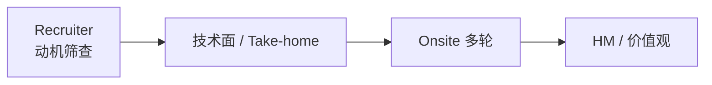

# FDE 面试通关：全景、框架与公司对照

> 本文整理自开源知识库 [VanGong1999/FDE](https://github.com/VanGong1999/FDE)（MIT License）的「面试通关」部分，综合 [Exponent FDE Interview Guide 2026](https://www.tryexponent.com/blog/forward-deployed-engineer-interview-the-definitive-2026-guide-fde)、[The Forward Deployed](https://www.theforwarddeployed.io/) 与各公司公开招聘信息。

FDE 面试不是标准后端 LeetCode 流水线，而是 **工程能力 × 问题拆解 × 客户判断 ×（常有）AI 生产化** 的组合。

> 轮次随团队/年份变化，**以招聘官邮件为准**。以下为公开报道与社区信息的综合画像（约 2025–2026），薪酬数字为 Levels.fyi 自报数据，仅供方向参考。

---

## 1. 面试全景：轮次与考点



| 轮次类型 | 考什么 | 你要展示 |
|----------|--------|----------|
| Recruiter | 动机、前线意愿、沟通 | 清晰故事：为何 FDE |
| Coding | 实用工程 | 正确、可读、沟通 |
| Decomposition | 模糊问题拆解 | 用户/指标/硬点/下一步 |
| Learning | 陌生代码库 | 快速变有用 |
| System / LLM Design | 方案 | 约束、eval、rollout |
| Take-home | 作品 + 演示 | 生产形完整度 |
| Behavioral | 所有权与冲突 | STAR + 结果 |
| HM / Values | 匹配度 | 诚实、使命、判断 |

### 常见淘汰原因

- 一上来堆功能，不定义用户与指标
- Demo 思维，无 eval/权限/成本
- 不会推回（push back），只会答应
- 编码沟通差或无法读他人代码
- 动机是「只想碰模型」而非交付结果

---

## 2. 公司对照与备考权重

| 维度 | Palantir FDSE | OpenAI FDE | Anthropic Applied AI | Google Cloud FDE | AI 初创 |
|------|---------------|------------|----------------------|------------------|---------|
| 资历要求 | 区间最宽（应届至资深） | 5 年以上，端到端 ownership | 3 年以上，MCP 原生 | 多职级 | 看具体 JD |
| 编码强度 | 高 | 中（偏应用） | 中 | 约 1/4 时间写码 | 中高 |
| Decomposition | **极重要（招牌环节）** | 重要 | 重要 | 重要 | 中 |
| Take-home | 较少作主线 | 常见 | 可能有 | — | 常见 |
| LLM 深挖 | 视团队 | 很深 | 很深（安全/eval） | 平台+AI | 深 |
| 薪酬参考（Levels.fyi 自报） | 中位 ~$201k | 高于市场 | 高于市场 | 多档 | 波动大 |

要点解读：

- **Palantir**：FDSE 模式的发明者，面试以「问题拆解」为核心而非算法；资历区间最宽，是职业早期最敞开的门。其面试方法论资料最充分、最适合备考。
- **OpenAI**：要求最多经验，强调端到端 ownership——从 discovery、技术范围界定、系统设计到构建与生产上线，「进展依赖代码时」直接动手。
- **Anthropic**：明确要求交付用于生产的 **MCP 服务器、子代理与 agent skills**，强调 high agency 与驾驭模糊性。
- **Google Cloud**：同一个头衔横跨多个职级；「创始人思维」的实际含义是「没人给你规格说明，范围蔓延是你自己的问题」。
- **初创公司**：意味着「派到客户那里、什么都得干」，考察无结构约束下的全面性与 ownership。

### 按目标公司分配备面时间

| 目标 | 备面权重（示例） |
|------|------------------|
| Palantir 向 | 拆解口述 30% · 实用编码（图/SQL）30% · 陌生代码库 20% · 行为面 20% |
| OpenAI 向 | Take-home 级项目（eval+安全+成本+rollout）35% · RAG/Agent 深挖 25% · 方案设计 20% · 行为面 20% |
| Anthropic 向 | LLM 系统设计（安全、HITL、审计）30% · Eval 与失败分析 25% · 编码 20% · 价值观 25% |

---

## 3. Decomposition 拆解面（标志性轮次）

面试官给出模糊、常被「伪造成解决方案」的业务诉求（「给我们做一个员工 ChatGPT」），考你能否在压力下结构化拆解。

### 五步框架

| 步 | 动作 | 合格样子 |
|----|------|----------|
| 1 | **用户与结果** | 先说清为谁、被什么指标衡量；不先谈 App/Chatbot |
| 2 | **假设与范围** | 大声假设并向面试官确认；划出非目标 |
| 3 | **拆子问题** | 3–5 个**问题部件**（不是「调研→开发→上线」这种阶段） |
| 4 | **硬点** | 指出做错会让结果崩掉的那块，并辩护为何硬 |
| 5 | **具体下一步** | 可执行、可证伪；说明如何知道自己错了 |

### 开场 60 秒脚本（练到不看稿）

```text
我想先确认用户和成功标准，再拆问题。
我假设……——这样合理吗？
在此基础上，我会避免……（非目标）。
关键子问题是：1… 2… 3…
其中最硬的是……因为……
我下一步会……；若看到……说明假设错了。
```

### 扣分最快的行为

第一分钟就聊技术栈 · 长时间「架构」却无任何具体物 · 子问题写成项目管理阶段 · 硬点说成「需要微服务」这类空话 · 等面试官问才说如何验证。

### 练习题（每题限时 8–10 分钟口述 + 录音自评）

1. 「给我们做一个员工 ChatGPT。」→ 硬点常是**权限与过期知识**
2. 「用 AI 做智能客服，下周要上。」→ 先问指标是首响还是一次解决率；影子模式起步
3. 「把所有合同自动审核掉。」→ 拆条款类型；高风险条款必须 HITL
4. 「做一个销售预测仪表盘。」→ 伪造成解决方案；先问谁的决策、预测周期
5. 「老板要生成式 BI，人人用自然语言查数。」→ 硬点是 Text-to-SQL 的正确性与权限

---

## 4. C.A.S.E. 框架与 Delta

接到系统设计/案例题，先别写码：

| 步 | 英文 | 做什么 |
|----|------|--------|
| **C** | Clarify | 数据量、安全（PII/PHI）、Definition of Done |
| **A** | Architect | 从源系统到用户界面的数据流 |
| **S** | Solve (**Delta**) | 产品开箱缺什么，胶水如何补 |
| **E** | Evaluate | 如何证明不幻觉、如何监控 |

**Delta** 是 Palantir 语境里的核心概念：产品（Dev）之外，让它在客户场景真正跑起来所缺的那部分工程（Delta）——集成、权限、数据管道、评测、变更管理。面试官想听你说清「**这个场景下 Delta 是什么**」。

### 示例：医院再入院预测（30 天叙事）

**情景**：医院集团要用软件预测再入院；二十年 on-prem SQL Server；零云；极强 HIPAA 合规。

| 阶段 | 动作 |
|------|------|
| Day 1–7 | 数据画像；与 CMO 定义「再入院」窗口；与感到被威胁的 IT 建信任 |
| Day 8–15 | Landing Zone：对象存储摄入 + 仓存储；脱敏方案满足 HIPAA |
| Day 16–25 | 检索/Agent 接地病史；**Delta**：实时生命体征接入更新预测 |
| Day 26–30 | 对照历史结局做评测；5 名医生 UAT——行为没改变则项目失败 |

### 评分自检（每题后打勾，缺两项以上重录）

- [ ] 开场 60 秒内澄清成功标准与约束
- [ ] 画出数据/控制流（哪怕方框）
- [ ] 明确说出 **Delta**（产品缺什么）
- [ ] 提到安全或合规至少一点
- [ ] 提到如何证明有效（Eval/UAT/指标）
- [ ] 提到采用或干系人至少一点
- [ ] 有意说了「非目标」或分阶段

---

## 5. 行为面：STAR 与「推回」

行为面考所有权与冲突处理。高频题：

- 为何选择 FDE？（答案要落在「对客户结果负责」，不是「想接触新模型」）
- 讲一次你说服客户放弃原始需求 / 对客户说不的经历
- 讲一次最严重的事故与你的处理
- 长期出差/驻场你能接受吗？
- 客户说「差不多就行」怎么回应？（用「校准式诚信」：明确说清当前准确率、与目标的差距、达成路径）

准备方法：把经历写成 STAR（情境-任务-行动-结果），**结果必须量化**，且至少一个故事含「推回范围」或「敌意干系人」。

---

## 6. 简历法则

Bullet 结构：**拥有的行动 + 困难环境 + 工程决策 + 可衡量的结果**。

| 弱写法 | 强写法 |
|--------|--------|
| 用 Python 和向量数据库构建了一个 RAG 聊天机器人 | 为 60 名分析师交付权限感知的研究助手；建立检索评测并把失败搜索减少 31% |
| 与客户合作收集需求 | 把客户要求的仪表盘重构为异常工作流，与两名操作员试点，人工复核时间减少 22% |
| 改进应用性能 | 在固定预算下引入缓存与模型路由，p95 延迟降低 41%，单任务成本降低 28% |

删掉：没有支撑的形容词、庞大工具清单、挤掉「已交付工作」的课程作业。**关键词帮你被发现，证据帮你赢下面试。**

### 4–6 周备面计划（速查）

| 周 | 动作 |
|----|------|
| 1 | 角色认知 + 自评；定 1 个主目标公司类型；改简历 |
| 2 | Decomposition 每日 1 题口述；补编码底线 |
| 3 | LLM/RAG/Eval 深挖问答；做一个可演示的小项目 |
| 4–5 | 按目标公司权重刷对应轮次；Take-home 级项目收尾 |
| 6 | 模拟面试（AI 当面试官）；90 秒自我介绍录音打磨 |

---

## 7. Recruiter 电话：90 秒标准题

1. 自我介绍（背景 → 客户/结果经历 → 为何 FDE）
2. 为何本公司（产品 + 前线模式 + 你的匹配）
3. 能否出差/驻场
4. 薪资区间（按你的策略）
5. 最近项目深挖预告（留钩子）

---

## 8. 读完马上做

- [ ] 选定 1 个主目标公司类型，按 §2 分配下周备面时间
- [ ] 写 90 秒自我介绍并录音
- [ ] 对 §3 练习题任选 1 题，限时 8 分钟口述并按五步自评
- [ ] 把简历最强的一条改写成「结果句」

姊妹篇：[全栈 AI Agent 工程师面试高频题](./agent-04-interview.md)
