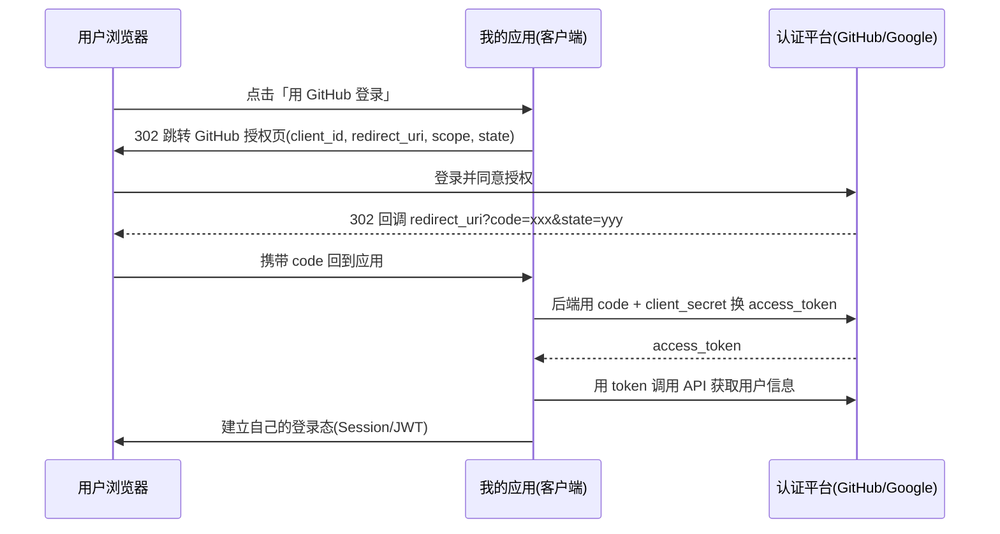

# 认证与鉴权：Session、JWT、OAuth2 与 SSO

> 全栈绕不开的一课：登录态怎么维持、Token 怎么存、第三方登录怎么接、企业单点登录怎么做。文中概念与 [Redis](./redis.md)（会话存储）、[FDE 的企业 SSO](/blogs/ai-jobs/fde-03-ai-landing.md) 相互衔接。

---

## 1. 先分清两个词

- **认证（Authentication）**：你是谁 —— 校验身份（密码、验证码、指纹）
- **授权（Authorization）**：你能干什么 —— 校验权限（RBAC 角色、ABAC 属性）

面试时混用这两个词是常见的减分项。HTTP 是无状态的，认证的本质是：**第一次证明身份后，发一个「凭证」，后续请求携带凭证证明「我还是那个已认证的人」**。凭证的两种主流形态就是 Session 和 JWT。

---

## 2. Session/Cookie：有状态的经典方案

```mermaid
sequenceDiagram
  participant B as 浏览器
  participant S as 服务端
  B->>S: 登录(账号+密码)
  S->>S: 校验通过，创建 session(存 Redis/DB)
  S-->>B: Set-Cookie: sid=xxx; HttpOnly; SameSite=Lax
  B->>S: 后续请求自动带 Cookie(sid)
  S->>S: 按 sid 查 session → 识别用户
```

关键在 **Cookie 的安全属性**，每个都有明确用途：

| 属性 | 作用 |
|------|------|
| `HttpOnly` | JS 读不到 → **防 XSS 偷凭证** |
| `Secure` | 仅 HTTPS 传输 |
| `SameSite=Lax/Strict` | 跨站请求不带 → **防 CSRF**（Chrome 2020 起 Lax 为默认） |
| `Domain/Path` | 作用范围最小化 |

- **优点**：服务端可控（随时踢人下线、改权限立即生效）、凭证不暴露给 JS
- **代价**：服务端要存会话（内存 → 集群要共享存储，通常 [Redis](./redis.md)）；移动端/第三方对接不如 Token 方便

**CSRF 补课**：Cookie 会被浏览器自动携带，攻击者诱导用户访问恶意页面发起跨站请求。防御三件套：SameSite Cookie + CSRF Token（表单隐藏字段/自定义头）+ 校验 Origin/Referer。

---

## 3. JWT：无状态的令牌方案

### 3.1 结构与原理

JWT（RFC 7519）= `Header.Payload.Signature` 三段 Base64URL：

```json
// Header  {"alg": "RS256", "typ": "JWT"}
// Payload {"sub": "1001", "name": "rain9", "role": "admin", "exp": 1790000000}
// Signature = 签名算法(前两段, 密钥)
```

- **签名保证不可篡改**：改了 payload，签名对不上；但 **payload 只是 Base64，不是加密**——任何人都能解码看到内容，**绝不能放敏感信息**
- **HS256**（对称）：签发与校验同一个密钥，适合单体；**RS256/ES256**（非对称）：私钥签发、公钥校验，适合微服务/第三方校验
- 校验只需密钥（或公钥），**不需要查库** —— 这就是「无状态」，天然适合分布式与横向扩展

### 3.2 绕不开的三个工程决策

| 决策 | 权衡 |
|------|------|
| **存哪里** | `localStorage`：方便但 **XSS 可偷**；`HttpOnly Cookie`：防 XSS 但要处理 **CSRF** 与跨域。敏感系统推荐 HttpOnly Cookie + CSRF 防护 |
| **怎么登出/踢人** | JWT 签发后**在过期前天然有效**（无状态的反面）。方案：短有效期 + **Refresh Token**（服务端存储可吊销）+ 黑名单/版本号 |
| **有效期多长** | Access Token 15min–2h + Refresh Token 7–30 天 + **刷新时轮换**（旧 refresh 作废，被盗用可检测） |

> 一句话总结 Session vs JWT：**Session 把状态放服务端（可控、可踢人），JWT 把状态放令牌里（无状态、可扩展）**。多数中大型系统折中：短 JWT + 服务端可吊销的 Refresh Token。

---

## 4. OAuth2 / OIDC：第三方登录与企业 SSO

### 4.1 授权码模式（现在的唯一推荐）



必须知道的点：

- **code 换 token 在后端完成**（client_secret 不经过浏览器）
- **state 参数防 CSRF**（回调时校验）；**PKCE**（RFC 7636）：无后端的 SPA/移动端用 `code_verifier/challenge` 替代 client_secret，OAuth 2.1 起是所有客户端的推荐
- **Implicit 隐式模式已被废弃**（token 走 URL 前端暴露）——老资料还在教它，别用

### 4.2 OIDC 与 SSO

- **OIDC（OpenID Connect）= OAuth2 + 身份层**：OAuth2 解决「授权访问资源」，OIDC 补上「你是谁」——多返回一个 **id_token（JWT 格式）** 与 UserInfo 端点。「用 Google/GitHub 登录」实际都是 OIDC
- **SSO 单点登录**：一处登录，处处通行。企业内部常见方案：OIDC（新主流）、SAML 2.0（老牌企业级）、CAS。核心思想一致——**统一的认证中心 + 各应用重定向认证 + 令牌互通**
- 微服务内部还有一道「服务间认证」：mTLS、Service Account Token 或内部 JWT——与用户认证分开设计

---

## 5. 权限模型：RBAC 与 ABAC

| 模型 | 思路 | 例子 |
|------|------|------|
| **RBAC** | 用户 → 角色 → 权限 | admin/editor/viewer |
| **ABAC** | 按属性动态判断（用户/资源/环境） | 「只能看自己部门的工单」「工作时间才可导出」 |

- 前端隐藏按钮只是 **UX**，真正的鉴权必须在**每个 API 端点**做（服务端不信任任何客户端）
- 数据级权限（「只能看自己的数据」）最容易漏：所有查询都带上 `where user_id = 当前用户`，或统一在数据层做行级过滤
- Agent 时代新命题：**AI 以谁的身份调用工具？**——运行时身份最小化，见 [AI 落地技术栈](/blogs/ai-jobs/fde-03-ai-landing.md)

---

## 6. 落地清单

- [ ] 密码存储用 **bcrypt 或 argon2**（绝不明文/MD5/SHA1）
- [ ] Cookie 三件套：HttpOnly + Secure + SameSite；CSRF Token 兜底
- [ ] JWT 短有效期 + Refresh 轮换 + 服务端可吊销
- [ ] 登录接口限流 + 失败锁定（防爆破）
- [ ] 所有端点默认拒绝（deny by default），权限校验放服务端
- [ ] 第三方登录走授权码 + PKCE + state 校验
- [ ] 审计日志：登录、改权、敏感操作留痕

> 延伸：[Redis 会话存储](./redis.md) · [Nginx 与 HTTPS](./Nginx.md) · [企业 SSO 与权限模型（FDE 视角）](/blogs/ai-jobs/fde-03-ai-landing.md)
