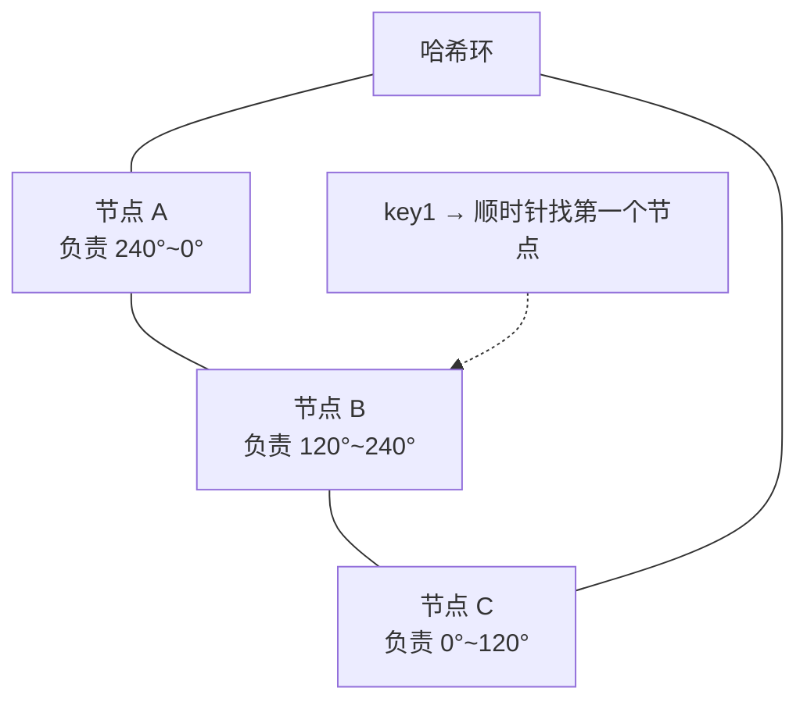
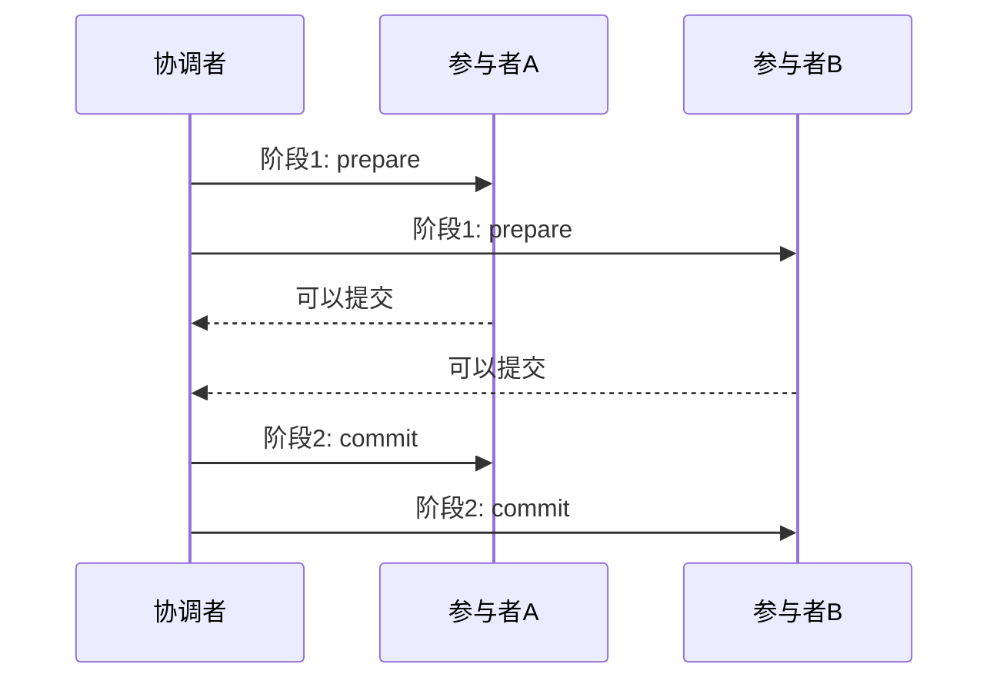

# 分布式系统基础：CAP、一致性哈希与分布式事务

> 单机玩得转之后，「多台机器怎么像一台机器一样可靠」就是新的战场。本文是纯理论 + 工程折中的底座篇，[系统设计题](./system-design.md)、[消息队列](./mq.md)、[MySQL 主从](./mysql.md)、[Redis 集群](./redis.md) 都站在这块地基上。

---

## 1. CAP 与 BASE：先接受不完美

**CAP 定理**：分布式系统在以下三者中**最多同时满足两个**：

- **C（Consistency）一致性**：所有节点在同一时刻看到相同数据
- **A（Availability）可用性**：每个请求都能得到（非错误）响应
- **P（Partition Tolerance）分区容忍**：网络分区（节点间断联）发生时系统仍能工作

关键认知：**网络分区在分布式系统中是必然事件，P 不能舍弃**——所以真实的选择永远在「分区发生时，要 C 还是要 A」：

| 取舍 | 含义 | 典型 |
|------|------|------|
| **CP** | 分区时拒绝服务，保一致性 | ZooKeeper、etcd、[分布式锁的强一致替代品](./redis.md) |
| **AP** | 分区时继续服务，容忍短暂不一致 | [Eureka](https://github.com/Netflix/eureka)、多数缓存集群、DNS |

日常工程更多谈 **BASE**（Basically Available 基本可用 / Soft state 软状态 / Eventually consistent 最终一致）：牺牲强一致换取可用与性能，**事后收敛**——你的[缓存一致性策略](./redis.md)、[主从复制延迟](./mysql.md)、[MQ 的最终一致](./mq.md)全是 BASE 思想。

> 面试表述要点：CAP 不是「三选二」的静态配置，而是**分区发生那一瞬间的决策**；未分区时（多数时间）C 和 A 可以兼得。

---

## 2. 一致性哈希：数据分片的经典算法

**问题**：按 `hash(key) % N` 分片，扩/缩容时几乎全部 key 要迁移。

**一致性哈希**把哈希空间组织成环（0 → 2³²）：



- **数据与节点都映射到环上，数据归属顺时针遇到的第一个节点**
- 节点下线：只迁移它的后继区间；**节点从 N 变 N+1，只动约 1/N 的数据**
- **虚拟节点**：物理节点映射成上百个虚拟点打散在环上，解决数据倾斜（节点少时原始方案分布不均）
- 实际应用：[Redis Cluster 用的哈希槽（16384 槽）是同思想的简化版](./redis.md)、负载均衡、分布式缓存

---

## 3. 分布式事务：四种方案与适用边界

跨服务/跨库的写操作如何保持原子？按「一致性强度 → 复杂度」排序：

### 3.1 2PC（两阶段提交）—— 强一致，同步阻塞



- 数据库/XA 事务、跨库 SDK 常见；**协调者单点、同步阻塞、网络抖动放大故障**——适合数据库层，不适合微服务业务层

### 3.2 TCC（Try-Confirm-Cancel）—— 业务层强一致

每个参与方实现三个接口：Try 预留资源（冻结库存）→ Confirm 确认扣减 → Cancel 释放。**性能好、无长锁，但业务侵入极大**（每个操作写三遍逻辑 + 空回滚/悬挂处理），适合金融核心链路。

### 3.3 Saga —— 长流程编排

把事务拆成一串本地事务，每步配一个**补偿动作**；失败时逆向补偿。编排式（状态机）或协同式（事件驱动）。适合长流程（下单 → 扣库存 → 配送），典型实现 Temporal/Camunda；[RocketMQ 的事务消息](./mq.md)是它的轻量变体。

### 3.4 本地消息表 —— 最朴素的最终一致（推荐默认）

```text
1. 业务操作与「待发送消息」在同一个本地事务落库
2. 后台任务扫描消息表投递到 MQ（重试直到成功）
3. 消费方幂等消费（见下节）
```

- 不引入新组件、消息不丢，代价是最终一致 + 一张表
- **大多数「跨库一致性」需求的默认答案**，别上来就 TCC

---

## 4. 幂等：分布式的第一必修课

重试无处不在（网络超时、MQ at-least-once、用户重复点击），**没有幂等，重试就是灾难**：

| 手法 | 实现 | 适用 |
|------|------|------|
| 唯一约束 | DB 唯一键 / upsert | 防重复创建，最可靠 |
| 去重表 | 消费前记录 msgId，插入冲突即重复 | 通用消费幂等 |
| 状态机 | `UPDATE orders SET status='PAID' WHERE status='PENDING'`，影响行数为 0 即重复 | 有状态流转的业务 |
| 乐观锁版本号 | `WHERE version = ?` | 更新类操作 |
| Token 机制 | 先领 token，提交时原子校验删除 | 表单防重复提交 |

---

## 5. 其他必备共识常识

- **Paxos / Raft**：多数派投票选主与日志复制。[Raft](https://raft.github.io/) 以可理解性胜出——[etcd](./k8s.md)、[Redis Sentinel 的选主](./redis.md)、[MongoDB 副本集选举](./mongodb.md)、TiKV 都是它的实现/变体；读一遍 Raft 论文或看 raft.github.io 的可视化动画，是分布式面试的高性价比投资
- **分布式锁回顾**：Redis 锁的性能 vs etcd/ZK 的强一致，按业务选，见 [Redis 分布式锁](./redis.md)
- **限流算法**：计数器（突刺）→ 滑动窗口 → 漏桶（恒定速率）→ **令牌桶**（允许突发，最常用）；单机用内存，集群用 [Redis + Lua](./redis.md)
- **时间与顺序**：跨机时钟不可信；全序靠逻辑时钟（Lamport）或单点排序（数据库/协调者），别用 `System.currentTimeMillis` 做跨机比较

---

## 6. 检查清单

- [ ] 说得清自己项目里哪个链路是 CP、哪个是 AP，为什么
- [ ] 跨服务的写操作有明确的方案（本地消息表 / Saga / TCC），不是「没有事务」
- [ ] 所有会被重试的接口做过幂等（至少唯一约束或状态机）
- [ ] 分片方案能回答「扩容时数据怎么迁」
- [ ] 分布式锁的失效场景与兜底说得出来

> 延伸：[系统设计题](./system-design.md) · [消息队列](./mq.md) · [Redis 集群与锁](./redis.md) · [K8s 与 etcd](./k8s.md)
