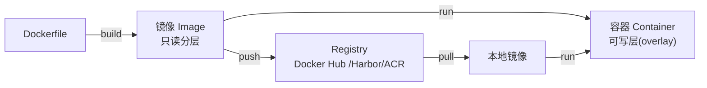

# Docker 从入门到生产

> 容器化是全栈交付的基本功：镜像与容器的原理、Dockerfile 最佳实践、网络与存储、Compose、资源限制与安全。掌握后自然衔接 [Kubernetes](./k8s.md)。

---

## 1. 核心概念：镜像、容器、仓库



- **镜像** = 只读文件系统分层（layer）的堆叠。每条 Dockerfile 指令生成一层，层可被复用与缓存
- **容器** = 镜像 + 一个可写层 + 独立的进程视图。本质是**被 Linux 内核隔离（namespace）与限额（cgroup）的普通进程**，不是虚拟机——没有 guest kernel，启动秒级
- 底层运行时是 **containerd / runc**（Docker 只是它们之上的友好封装，K8s 直接用 containerd）

**容器 vs 虚拟机**：VM 虚拟整套硬件 + 独立内核（重、慢、隔离强）；容器共享宿主内核（轻、快、隔离弱于 VM）。

---

## 2. Dockerfile 最佳实践（生产级模板）

```dockerfile
# ---- 语法检查要点：基镜像锁具体版本，不裸用 latest ----
FROM node:22-alpine AS deps
WORKDIR /app
# 先拷依赖清单再装依赖：充分利用层缓存，源码改动不触发重装
COPY package.json pnpm-lock.yaml ./
RUN corepack enable && pnpm install --frozen-lockfile

FROM node:22-alpine AS build
WORKDIR /app
COPY --from=deps /app/node_modules ./node_modules
COPY . .
RUN pnpm build

# ---- 运行镜像只带产物，体积从 1GB+ 降到 ~150MB ----
FROM node:22-alpine AS runtime
ENV NODE_ENV=production
WORKDIR /app
# 不用 root 跑容器（安全基线）
RUN addgroup -S app && adduser -S app -G app
COPY --from=build --chown=app:app /app/dist ./dist
COPY --from=build /app/node_modules ./node_modules
USER app
EXPOSE 3000
HEALTHCHECK --interval=30s --timeout=3s --retries=3 \
  CMD wget -qO- http://127.0.0.1:3000/healthz || exit 1
CMD ["node", "dist/main.js"]
```

逐条原则：

1. **多阶段构建**：编译工具链只存在于 build 阶段，运行镜像只拷产物
2. **层缓存友好**：变更频率低的指令放前面（依赖 → 源码）
3. **合并RUN、清理缓存**（`rm -rf /var/cache/apk/*`）减少层与体积
4. **显式 USER 非 root**；`EXPOSE` 是文档性声明，端口映射由 `-p`/compose 决定
5. **`.dockerignore` 必配**：`node_modules`、`.git`、`.env`（防密钥进镜像层！）
6. 基镜像选择：`alpine` 体积小但 musl libc 偶有兼容坑；追求极致可看 `distroless` / `scratch`（静态编译的 Go/Rust）
7. 一条 `CMD`/`ENTRYPOINT`，前台进程运行（容器主进程退出 = 容器停止）

---

## 3. 常用命令速查

```sh
docker build -t myapp:1.0 .            # 构建（buildx 支持 --platform 多架构）
docker run -d --name api -p 3000:3000 \
  -e NODE_ENV=production --memory=512m --cpus=1 myapp:1.0
docker ps -a / docker images           # 查看容器/镜像
docker logs -f api / docker exec -it api sh
docker cp api:/app/log ./log           # 宿主与容器间拷贝
docker system df / docker system prune # 磁盘占用与清理
docker scout cves myapp:1.0            # 镜像漏洞扫描
```

---

## 4. 网络

| 模式 | 行为 | 场景 |
|------|------|------|
| bridge（默认） | 容器接入 docker0 网桥，通过 `-p 宿主:容器` 端口映射对外 | 单机默认 |
| host | 共享宿主网络栈，无隔离 | 高性能本机部署 |
| none | 无网络 | 沙箱/离线任务 |

- **同一 compose 项目内的容器用服务名互访**（内置 DNS）：`http://db:5432`，不要用 IP
- 容器间同网络直接互通，跨网络需手动 connect；`-p` 只影响宿主与外部访问
- 记住端口语义：`-p 8080:3000` 是「宿主 8080 → 容器 3000」

---

## 5. 存储：三种挂载

| 类型 | 命令 | 生命周期 | 场景 |
|------|------|----------|------|
| **volume**（推荐） | `-v mydata:/var/lib/postgresql/data` | Docker 管理，独立于容器 | 数据库数据、状态 |
| bind mount | `-v /host/path:/container/path` | 跟宿主目录 | 开发时热载源码 |
| tmpfs | `--tmpfs /app/tmp` | 内存，容器停止即失 | 临时敏感数据 |

数据库容器务必用 volume；容器可写层随容器删除而消失，**别把持久数据放里面**。

---

## 6. Docker Compose（多容器编排）

```yaml
services:
  api:
    build: .
    ports: ["3000:3000"]
    environment:
      DATABASE_URL: postgres://app:secret@db:5432/app
    depends_on:
      db: { condition: service_healthy }   # 等依赖健康再启动
    restart: unless-stopped
    deploy:
      resources:
        limits: { memory: 512M, cpus: "1.0" }
  db:
    image: postgres:16-alpine
    environment:
      POSTGRES_PASSWORD: secret
    volumes: ["pgdata:/var/lib/postgresql/data"]
    healthcheck:
      test: ["CMD-SHELL", "pg_isready -U app"]
      interval: 5s
volumes:
  pgdata:
```

```sh
docker compose up -d / docker compose logs -f api
docker compose build --no-cache
```

---

## 7. 资源限制与排障

- `--memory=512m`：超限触发 OOM Killer 杀容器主进程（exit 137 的常见原因）
- `--cpus=1.0`：CPU 配额
- 排障三板斧：`docker logs`（stdout/stderr）→ `docker exec` 进容器 → `docker stats` 看实时资源
- **日志落盘**：容器内只写 stdout，收集交给宿主/平台（Fluentd、云日志），不要在容器里管理日志文件

---

## 8. 安全清单

- [ ] 非 root 用户运行；只读根文件系统（`--read-only` + 显式可写卷）酌情开启
- [ ] 镜像扫描进 CI（trivy / docker scout），阻塞高危漏洞
- [ ] 密钥走运行时注入（环境变量/secret 管理），**绝不写进镜像层**
- [ ] 最小化基础镜像、固定 tag、定期重建拉安全补丁
- [ ] 单容器单进程，信号处理（PID 1 要能响应 SIGTERM，优雅停机）

---

## 9. 与 Kubernetes 的关系

Docker/Compose 解决「单机怎么跑起来」；当容器多了，需要跨多机调度、自愈、弹性伸缩、服务发现，就是 [Kubernetes](./k8s.md) 的领域。K8s 底层同样是 containerd，镜像完全复用——**会写 Dockerfile 是学 K8s 的前置条件**。

> 延伸：[Kubernetes 入门](./k8s.md) · [Nginx](./Nginx.md) · [Linux](./linux.md) · [消息队列](./mq.md)
