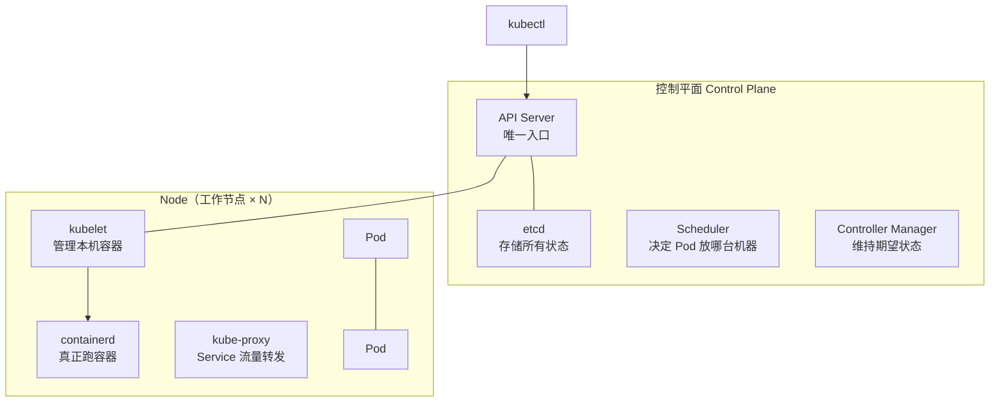

# Kubernetes 入门到上手

> 容器编排的事实标准。本文从「为什么需要」讲到核心对象、部署与扩缩容，定位是**全栈工程师的够用深度**：看得懂部署清单、能排障、知道边界在哪。前置知识：[Docker](./docker.md)。

---

## 1. 为什么需要 K8s

Docker/Compose 解决单机；多机时问题全来了：容器挂了谁重启？流量怎么分到健康实例？发版怎么不停机？机器满了怎么扩？K8s 用声明式 API + 控制循环回答这一切：

- **声明式**：你描述「期望状态」（跑 3 个副本、用这个镜像），K8s 持续比对现实并自动收敛
- **自愈**：容器挂了自动重启，节点宕机自动迁移
- **水平扩缩容、滚动更新、服务发现、配置管理**：都是内置能力

---

## 2. 架构一图



记忆点：**所有操作都走 API Server，所有状态都存 etcd**；kubelet 在每台工作节点上听命于 API Server。

---

## 3. 核心对象（掌握这 8 个就够日常）

| 对象 | 一句话 | 关键点 |
|------|--------|--------|
| **Pod** | 最小调度单位，1~N 个共享网络/存储的容器 | 容器不是调度单位，Pod 才是；IP 每个 Pod 独立 |
| **Deployment** | 无状态应用的管家 | 声明副本数/镜像，负责滚动更新与回滚 |
| **Service** | 一组 Pod 的稳定访问入口（虚拟 IP） | 通过 label 选择器绑定 Pod；Pod 换 IP 无影响 |
| **Ingress** | 七层入口：域名/路径 → Service | 需搭配 Ingress Controller（nginx/traefik）实现 |
| **ConfigMap** | 配置与代码分离 | 以环境变量或文件挂载进容器 |
| **Secret** | 敏感配置 | base64 编码（非加密！），生产配外部 KMS/Vault |
| **StatefulSet** | 有状态应用 | 稳定主机名与顺序部署，数据库/中间件用 |
| **PV / PVC** | 存储的供给侧与申请侧 | Pod 生命 ≠ 数据生命，持久数据必挂 PVC |

### 一份最小可读的 Deployment + Service

```yaml
apiVersion: apps/v1
kind: Deployment
metadata:
  name: api
spec:
  replicas: 3
  selector:
    matchLabels: { app: api }
  template:
    metadata:
      labels: { app: api }        # Service 靠这个 label 找到 Pod
    spec:
      containers:
        - name: api
          image: registry.example.com/myapp/api:1.4.2   # 固定 tag，别用 latest
          ports: [{ containerPort: 3000 }]
          resources:
            requests: { cpu: 100m, memory: 128Mi }  # 调度依据
            limits:   { cpu: 500m, memory: 512Mi }  # 硬上限（超限 OOMKill）
          readinessProbe:           # 就绪才接流量
            httpGet: { path: /healthz, port: 3000 }
          livenessProbe:            # 不通就重启
            httpGet: { path: /healthz, port: 3000 }
          envFrom:
            - configMapRef: { name: api-config }
---
apiVersion: v1
kind: Service
metadata:
  name: api
spec:
  selector: { app: api }
  ports: [{ port: 80, targetPort: 3000 }]
```

---

## 4. 发布：滚动更新与回滚

```sh
kubectl set image deploy/api api=myapp/api:1.5.0
kubectl rollout status deploy/api
kubectl rollout undo deploy/api          # 一键回滚
kubectl rollout history deploy/api
```

滚动更新逻辑：按 `maxSurge`/`maxUnavailable` 先起新 Pod → readinessProbe 通过 → 杀旧 Pod，循环推进。**readiness 探针就是不停机的关键**：未就绪的 Pod 会被自动摘出 Service 后端。

---

## 5. 弹性伸缩

| 类型 | 对象 | 依据 |
|------|------|------|
| HPA（Horizontal） | Pod 副本数 | CPU/内存利用率或自定义指标 |
| VPA | Pod 资源规格 | 实际用量建议/调整（与 HPA 同用需谨慎） |
| Cluster Autoscaler | 节点数 | Pod 调度不下时加机器 |

```sh
kubectl autoscale deploy api --min=3 --max=10 --cpu-percent=70
```

---

## 6. 全栈工程师的「够用边界」

**必须会**：

- 写/看 Deployment + Service + Ingress + ConfigMap 清单
- `kubectl get/logs/describe/exec port-forward` 五连排障
- 理解探针、资源 requests/limits、滚动更新

**常用命令**：

```sh
kubectl get pods -o wide / kubectl describe pod api-xxxx   # 事件与失败原因都在 describe 里
kubectl logs -f api-xxxx --previous                        # 看上一次崩溃的日志
kubectl exec -it api-xxxx -- sh
kubectl port-forward svc/api 3000:80                       # 本地调试
kubectl top pods                                           # 资源用量（需 metrics-server）
```

**知道即可**（用到再学）：Helm（应用包管理，模板化清单）、Operator（有状态应用自动化）、CRD（自定义资源）、Service Mesh（Istio 流量治理）、GitOps（ArgoCD/Flux，清单进 git 自动同步）。

**排障心法**：Pod 起不来先 `describe` 看 Events（镜像拉取失败/资源不足/探针失败三大件），再看 logs；`CrashLoopBackOff` 多半是应用自身启动即崩，`--previous` 看崩溃前日志。

---

## 7. 落地建议

- [ ] 本地用 minikube / kind / docker desktop K8s 起个集群练手
- [ ] 把自己的服务容器化并写成 Deployment 部署上去，配齐三种探针
- [ ] 体验一次「杀掉 Pod → 自动重建」「改镜像 → 滚动更新 → undo 回滚」
- [ ] 生产用托管服务（ACK/EKS/GKE/TKE），别自己运维控制平面

> 延伸：[Docker](./docker.md) · [Nginx](./Nginx.md) · [消息队列](./mq.md) · [后端架构设计](./后端架构设计.md)
