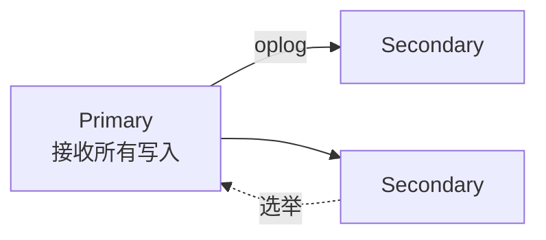
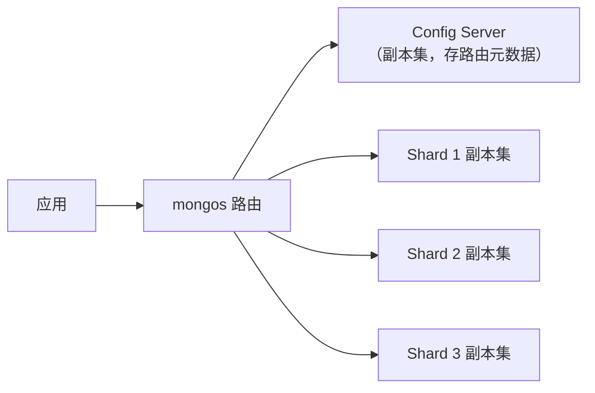

# MongoDB 核心知识体系

> 文档型数据库的完整主线：文档模型与设计、副本集、分片、聚合管道、事务边界。适合「结构灵活、读多写多、聚合分析」的场景。基线 **MongoDB 6.0/7.0 + WiredTiger 引擎**。

---

## 1. 文档模型

- 存储单位是 **BSON 文档**（二进制 JSON），集合（collection）≈ 表，文档 ≈ 行，但**无固定 schema**——同集合字段可以不同
- 内嵌文档与数组让「一对少」关系一次取回，免 JOIN
- 单文档上限 **16MB**，超出走 GridFS 或对象存储 + 存引用
- `_id` 默认 ObjectId（时间戳 + 机器 + 进程 + 计数器，天然粗略有序）

### 建模核心决策：Embed 还是 Reference

| 场景 | 选择 | 理由 |
|------|------|------|
| 一对少量、一起读写（订单项） | **内嵌** | 一次查询取全，无 $lookup 开销 |
| 一对海量（评论数万+） | **引用**（分页查询子集合） | 避免巨大数组与 16MB 限制 |
| 被多个父实体共享（商品信息） | **引用** | 内嵌会产生数据冗余与同步成本 |
| 频繁独立更新的字段 | 引用或拆集合 | 减少文档锁竞争 |

反模式警告：无界增长的数组（massive arrays）、万物皆内嵌、完全照搬关系模型的第三范式。

---

## 2. 索引与查询

```javascript
// 单字段 / 复合（同样有最左前缀）/ 唯一 / 部分索引
db.orders.createIndex({ userId: 1, createdAt: -1 })
db.orders.createIndex({ orderNo: 1 }, { unique: true })
db.orders.createIndex({ status: 1 }, { partialFilterExpression: { status: "PENDING" } })

// 文本检索（简单场景）；复杂全文走 Atlas Search / ES
db.articles.createIndex({ title: "text", body: "text" })

// TTL 索引：自动清理过期文档（会话、日志类）
db.sessions.createIndex({ createdAt: 1 }, { expireAfterSeconds: 3600 })
```

- `explain("executionStats")` 看是否 `IXSCAN`、扫描行数比；`COLLSCAN` 即全表扫
- 与 MySQL 类似：覆盖查询（projection 只取索引字段）免回表（FETCH）

---

## 3. 副本集（Replica Set）



- **oplog**（操作日志）：主节点写操作滚动记录，从节点重放；相当于 MySQL binlog
- **选举**：基于 Raft 变体，需要**多数派存活**才能选出主节点（3 节点副本集最多容忍 1 台宕机；2 台宕机则整组只读）
- **Arbiter**：不存数据的投票成员，凑奇数用（生产更建议用真从节点凑奇数）
- **读写关注（读写语义的关键）**：
  - Write Concern：`w:1`（主写入即返回）/ `w:"majority"`（多数派确认，防回滚）/ `j:true`（journal 落盘）
  - Read Concern：`local` / `majority`（不会读到被回滚的数据）/ `linearizable`（最强，慢）
  - Read Preference：`primary` / `primaryPreferred` / `secondary`（读扩散，注意复制延迟下的旧读）

---

## 4. 分片（Sharding）



- **Shard Key 是最难且影响最深远的决策**（MongoDB 5.0 起支持 `reshardCollection` 在线重分片，但过程重、消耗资源——初始设计仍要慎重）：
  - 高基数 + 写入均匀：单调递增的 key（如时间戳）会把写入全打到最后一个分片（热点）
  - 范围分片：利于范围查询；**哈希分片**：写入均匀但范围查询要 scatter-gather
  - 查询必须带 shard key（或其前缀）才能定向到单分片
- 数据按 chunk（块）切分，balancer 自动在分片间迁移均衡
- 客户端连接 mongos（或驱动直连，行为一样）；跨分片查询/事务代价高

---

## 5. 聚合管道（Aggregation Pipeline）

MongoDB 的「SQL 分析等价物」，数据流经一系列阶段：

```javascript
db.orders.aggregate([
  { $match: { status: "PAID", createdAt: { $gte: ISODate("2026-01-01") } } }, // 先过滤（用索引）
  { $group: { _id: "$userId", total: { $sum: "$amount" }, cnt: { $sum: 1 } } },
  { $sort: { total: -1 } },
  { $limit: 100 },
  // 关联：$lookup ≈ LEFT JOIN
  { $lookup: { from: "users", localField: "_id", foreignField: "_id", as: "user" } },
  { $unwind: "$user" },
  { $project: { "user.name": 1, total: 1, cnt: 1 } },
])
```

性能要点：`$match`/`$sort` 尽量放最前并用上索引；`$lookup` 是 O(n) 嵌套查询，大表关联考虑反范式内嵌或应用层组装；超内存阶段（如大 `$group`）注意 `allowDiskUse`。

---

## 6. 事务与一致性

- **单文档操作天然原子**——把需要原子性的关联数据内嵌，是 MongoDB 建模的第一性原理
- **多文档事务**：4.0 支持副本集，4.2 支持分片集群。语法近似关系库（`startSession` → `startTransaction` → commit/abort）
- 代价：事务期间持有快照与锁，性能明显低于单文档操作——**能靠建模内嵌解决的不要上事务**
- 唯一约束、防重复提交等常用手法仍是唯一索引 + upsert

---

## 7. 选型对照与适用边界

| | MongoDB | MySQL | Elasticsearch |
|--|---------|-------|---------------|
| 模型 | 文档，schema 灵活 | 关系，强约束 | 倒排索引，搜索优先 |
| 事务 | 单文档强，多文档可用但慎用 | OLTP 强项 | 无（近实时） |
| 聚合分析 | 管道，中等 | 窗口函数，中等 | 全文/日志场景最强 |
| 适合 | 内容管理、用户画像、IoT、原型期快速迭代 | 核心交易账务 | 搜索、日志、可观测 |

> 延伸：[MySQL](./mysql.md) · [PostgreSQL](./PostgreSQL.md) · [Redis](./redis.md) · [ElasticSearch](./ElasticSearch.md)
