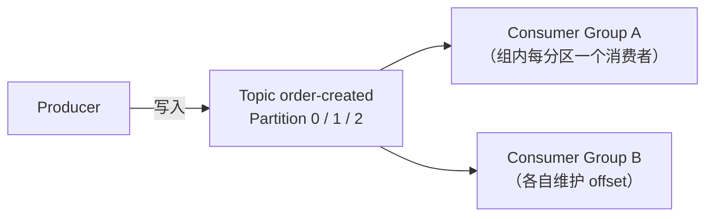
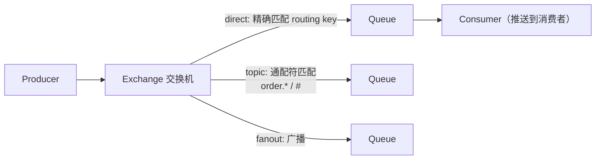

# 消息队列：Kafka、RabbitMQ 与可靠性设计

> 异步、解耦、削峰的标配组件。本文讲清「为什么需要 → 主流选型 → 丢失/重复/顺序三大经典问题 → 可靠性三端设计」。选型基线：Kafka 3.x/4.x、RabbitMQ 3.13+ / 4.x。

---

## 1. 为什么需要消息队列

| 价值 | 场景 |
|------|------|
| **异步** | 注册后发短信/发券：主流程落库即返回，通知走消息 |
| **解耦** | 订单系统的下游（库存/物流/积分）订阅事件，新增订阅方不改上游 |
| **削峰** | 秒杀请求先进队列，消费端按自身能力匀速处理 |

代价与边界：系统复杂度上升、一致性变成最终一致、需要处理重复与顺序问题。**强一致要求的场景（如扣款主链路）别用 MQ**——它适合「可以稍后、必须到达」的事。

---

## 2. 两大主流的模型差异

### 2.1 Kafka：分布式提交日志（拉模式）



关键概念：

- **分区（Partition）**：并行与顺序的单位。**同一分区内的消息有序，跨分区不保证**——需要顺序就把相关消息发到同一分区（按业务 key 哈希）
- **副本与 ISR**：每分区 1 主多从，同步副本集合 ISR；主宕机从 ISR 中选新主
- **消费组**：组内分区独占消费（水平扩容），组间广播；消费者数量超过分区数则多余者闲置
- **offset**：消费位点由消费组提交管理，可重置 → 天然支持「重放历史」（日志保留期内的数据都能重读）
- **可靠性语义**：`acks=all` + `min.insync.replicas≥2`（生产不丢）；幂等生产者（`enable.idempotence=true`）+ 事务可实现端到端 exactly-once
- 适合：日志/埋点流、事件流、大吞吐数据管道

### 2.2 RabbitMQ：AMQP 路由模型（推模式）



- **Exchange 类型**决定路由：direct（精确）、topic（`*.order` 通配）、fanout（广播）、headers
- 消费端**手动 ack**（`basicAck/nack`），nack 可 requeue 或进**死信队列 DLX**（重试/人工兜底的标准位置）
- 支持优先级队列、TTL、延迟插件；管理界面友好
- 适合：业务系统集成、任务分发、中小吞吐但路由灵活的场景

### 2.3 快速选型

| | Kafka | RabbitMQ | RocketMQ |
|--|-------|----------|----------|
| 吞吐 | 极高（百万级/s） | 万级/s | 高（十万级/s） |
| 模型 | 拉模式、日志可重放 | 推模式、消息确认 | 拉推结合，事务/延迟消息原生支持 |
| 顺序 | 分区内 | 队列内 | 队列内（顺序消息） |
| 典型场景 | 日志流、事件溯源、数据管道 | 业务解耦、任务队列 | 电商交易链路（阿里系生态） |

---

## 3. 三大经典问题（面试核心）

### 3.1 消息丢失（三个环节分别堵）

| 环节 | 丢失原因 | 方案 |
|------|----------|------|
| 生产端 | 网络失败未感知 | 同步/事务确认；Kafka `acks=all` + 重试；RabbitMQ publisher confirm |
| Broker | 宕机内存数据未落盘 | 持久化（队列+消息都 durable）；Kafka 副本 + `min.insync.replicas` |
| 消费端 | 自动 ack 后处理失败 | **手动 ack**：业务成功才 ack，失败 nack 重试 |

### 3.2 重复消费与幂等

MQ 只提供 **at-least-once**（Kafka exactly-once 有条件、代价高），重复不可避免，**幂等必须做在消费端**：

- 数据库唯一键 / upsert（最实用）
- 消息去重表（msgId 唯一约束）
- 状态机校验（订单已发货则忽略重复发货消息）
- Redis SETNX 去重（允许窗口期）

### 3.3 顺序

- 全局顺序：单分区/单队列 → 吞吐归零，基本不用
- **局部顺序（主流）**：同一业务实体（同一订单）的消息按 key 哈希到同一分区/队列，消费端单线程处理该分片
- 注意重试会破坏顺序：失败消息进入重试队列会「插队失败」——顺序场景用「阻塞重试」或接受顺序让位

---

## 4. 其他实战问题

- **积压**：临时扩消费者（Kafka 需同步扩分区）、消费逻辑降级（只做关键处理，其余落库后补）、批量拉取与批量写库
- **消息过期/回溯**：Kafka 按保留期（时间/大小）滚动删除，重置 offset 即可重放；RabbitMQ TTL + 死信组合
- **延迟消息**：RabbitMQ 延迟插件、RocketMQ 延迟等级；Kafka 无原生支持（按时间主题轮转或外置调度）
- **事务消息**：RocketMQ 半消息 + 回查解决「本地事务与发消息的原子性」；Kafka 用事务 API（常用于流处理 exactly-once）；通用替代方案：本地消息表 + 定时补偿

---

## 5. 消费端设计要点（工程落地）

```text
收到消息
  → 校验格式与版本
  → 幂等检查（唯一键/去重表）
  → 业务处理（本地事务内）
  → 手动 ack
  → 失败：有限次重试（带退避）→ 死信队列 + 告警
```

- 消费要**幂等 + 可重入**，重试与死信是标配而非可选项
- 监控三指标：积压量（lag）、消费延迟、死信速率
- 消息体带 traceId，链路追踪才能串起异步调用

---

## 6. 读完马上做

- [ ] 给现有异步通知改造：生产端 confirm + 消费端手动 ack + 幂等
- [ ] 为订单类消息设计「按订单 ID 分区」的顺序投递
- [ ] 配置死信队列与积压告警，做一次人为积压演练

> 延伸：[Redis Stream 与分布式锁](./redis.md) · [Docker](./docker.md) · [后端架构设计](./后端架构设计.md)
