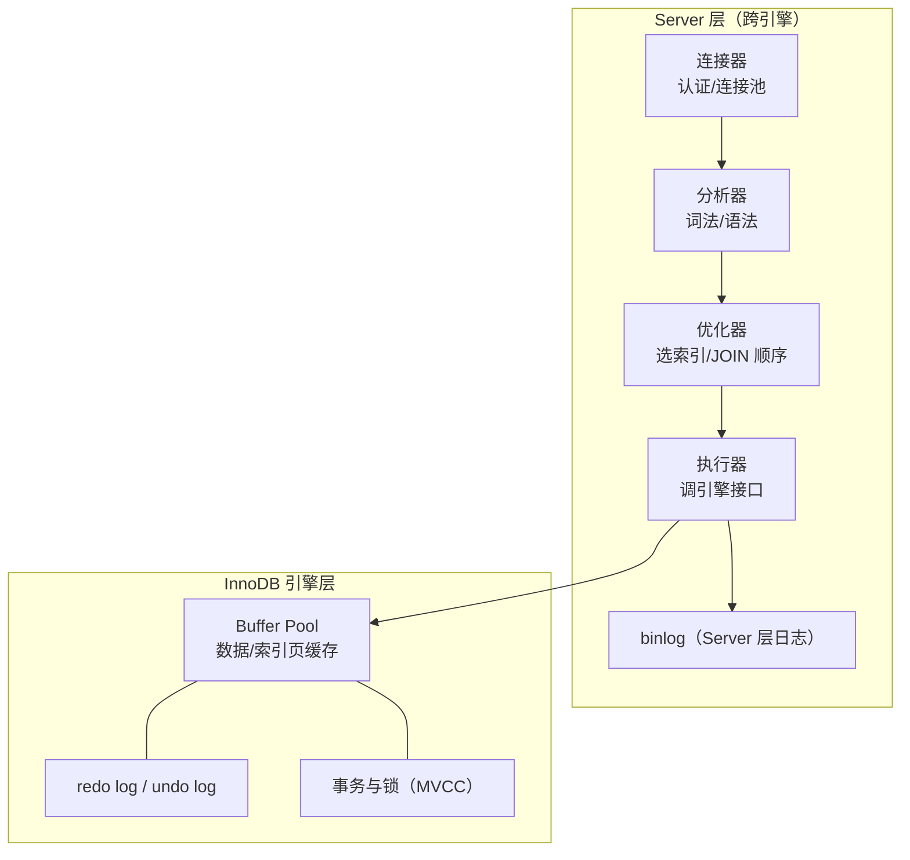

# MySQL 核心知识体系

> 面向全栈工程师的 MySQL 深度整理：架构、事务与 MVCC、索引、锁、日志链路、性能优化、高可用与扩展。默认讨论 **InnoDB 引擎 + MySQL 8.0/8.4 LTS**（PostgreSQL 对照见 [PostgreSQL 笔记](./PostgreSQL.md)）。

---

## 1. 整体架构



记忆点：**binlog 在 Server 层（所有引擎共有），redo/undo 在 InnoDB 层**。一个 SQL 的生命线：连接器 → （查缓存已移除）→ 分析器 → 优化器 → 执行器 → 引擎。

---

## 2. 事务：ACID、隔离级别与 MVCC

### 2.1 隔离级别与并发问题

| 隔离级别 | 脏读 | 不可重复读 | 幻读 |
|----------|------|-----------|------|
| READ UNCOMMITTED | 可能 | 可能 | 可能 |
| READ COMMITTED（RC） | 避免 | 可能 | 可能 |
| **REPEATABLE READ（InnoDB 默认）** | 避免 | 避免 | 基本避免* |
| SERIALIZABLE | 避免 | 避免 | 避免 |

\* InnoDB 在 RR 下通过 **MVCC（快照读）+ Next-Key Lock（当前读）** 把幻读基本堵住了——普通 SELECT 走一致性快照；`SELECT ... FOR UPDATE / UPDATE / DELETE` 这类当前读靠间隙锁阻止插入。这也是 MySQL 与 PG 的差异点之一（PG 默认 RC）。

### 2.2 MVCC 实现三件套

1. **隐藏列**：每行有 `trx_id`（最后修改事务）与 `roll_pointer`（指向 undo log 版本链）
2. **undo log**：旧版本链，回滚 + 多版本读取都靠它
3. **Read View**：读事务开始时（RC 为每条语句、RR 为第一次快照读）生成「活跃事务列表」，沿版本链找到对自己可见的版本

一句话：**RC 每条语句取新快照，RR 整个事务用第一次的快照**——这就是两种级别可重复性差异的全部来源。

---

## 3. 索引（面试 80% 的题在这）

### 3.1 B+ 树与两类索引

- **聚簇索引（主键）**：叶子节点存整行数据，表本身就是按主键组织的 B+ 树
- **二级索引（普通/唯一/联合）**：叶子存「索引列 + 主键值」——查到后还要**回表**（拿主键去聚簇索引查整行）

由此推出两条关键优化：

- **覆盖索引**：查询列全在二级索引里，免回表。例：`SELECT id, name FROM user WHERE name = ?`，在 `name` 上有索引即可覆盖（name + 主键 id）
- **最左前缀**：联合索引 `(a, b, c)` 相当于建立了 `(a)`、`(a,b)`、`(a,b,c)` 三个前缀；查询必须从最左列开始且连续才能充分利用

### 3.2 索引失效的典型姿势

| 写法 | 为什么失效 |
|------|-----------|
| `WHERE YEAR(create_time) = 2026` | 对列做函数/运算，破坏有序性 → 改成范围查询 |
| `WHERE phone = 13800000000`（列是 varchar，传了数字） | 隐式类型转换等价于对列加函数 |
| `LIKE '%abc'` | 前缀通配，无法走 B+ 树定位（`'abc%'` 可以） |
| `WHERE a = 1 OR c = 2`（c 无索引） | OR 一侧全表扫则整体扫 |
| 联合索引 `(a,b)` 只查 `b` | 违反最左前缀 |

### 3.3 explain 与慢查询

```sql
EXPLAIN SELECT ... ;
-- 关注：type（至少 range，最好 ref/eq_ref/const，ALL=全表扫）
--       key（实际用的索引）、rows（扫描行数）、Extra
--       Using index = 覆盖索引；Using filesort = 额外排序，优先消除
```

慢查询治理流程：慢日志定位 → explain 归因 → 索引/SQL 改写 → 数据量确认。深分页优化：

```sql
-- 差：OFFSET 1000000, 20 要扫过前 100 万行
SELECT * FROM t ORDER BY id LIMIT 1000000, 20;
-- 好：游标/键集分页，记录上一页最后的 id
SELECT * FROM t WHERE id > #{last_id} ORDER BY id LIMIT 20;
```

其他实用结论：`count(*)` InnoDB 没有缓存行数（MVCC 下「精确总数」因事务而异），大表统计走估算或计数表；JOIN 小表驱动大表，MySQL 8.0.18+ 有 hash join；字符串列尽量用 `utf8mb4`（8.0 默认），长度够用就好（影响索引大小）。

---

## 4. 锁

| 锁 | 粒度/说明 |
|----|-----------|
| 全局锁 | `FLUSH TABLES WITH READ LOCK`，逻辑备份用（或 `mysqldump --single-transaction` 走一致性快照） |
| 表锁 / 元数据锁（MDL） | DDL 会拿 MDL 写锁，长事务未提交会阻塞 DDL 并雪崩后续查询——**DDL 前先查长事务** |
| 行锁（record lock） | 锁的是**索引项**；无索引可用时会升级为锁全表所有记录（RC 下近似表锁效果） |
| 间隙锁（gap）/ Next-Key | RR 下当前读锁住区间防幻读；RC 基本没有间隙锁，这是许多公司线上用 RC 的原因 |

死锁：InnoDB 自动检测并回滚代价小的事务（`SHOW ENGINE INNODB STATUS` 可查）。预防：按相同顺序访问资源、小事务、索引到位减少锁范围。

---

## 5. 三大日志与两阶段提交

| 日志 | 层 | 作用 | 写入时机 |
|------|----|------|----------|
| **redo log** | InnoDB | 崩溃恢复（WAL：先写日志再刷数据页），物理日志，循环写 | 事务中顺序写 + 后台刷盘 |
| **undo log** | InnoDB | 回滚 + MVCC 版本链，逻辑日志 | 事务修改前 |
| **binlog** | Server | 复制 + 时间点恢复（PITR），逻辑日志（推荐 ROW 格式），追加写 | 事务提交时 |

**崩溃不丢数据的保证（两阶段提交）**：更新时先写 redo（prepare）→ 写 binlog → redo（commit）。恢复时以「redo prepare 且 binlog 完整」为准提交，保证主库与从库/恢复点一致。

```ini
# 可靠性关键参数（双 1 配置，金融级）
innodb_flush_log_at_trx_commit = 1   # redo 每次提交落盘
sync_binlog = 1                      # binlog 每次提交刷盘
```

---

## 6. 高可用与扩展

### 6.1 主从复制


- 格式：**ROW**（默认，最安全）、STATEMENT（可能主从不一致）、MIXED
- 模式：异步（可能丢尾部数据）→ **半同步**（至少一个从库确认收到 binlog）→ 组复制 MGR（Paxos 多数派）
- 延迟治理：并行复制（8.0 基于 WRITESET）、从库只读、大事务拆分

### 6.2 读写分离与分库分表

- 读写分离注意**复制延迟**：写后立即读走主库（粘性）或用 GTID 等待位点
- 垂直拆分（按业务/列）→ 水平拆分（按 shard key 取模/范围/一致性哈希）
- 水平拆分的代价：跨分片查询、分布式事务、全局 ID（雪花算法/号段）、扩容数据迁移——**不到数据量瓶颈别拆，先索引/读写分离/归档**

---

## 7. 与 PostgreSQL 快速对照

| 维度 | MySQL (InnoDB) | PostgreSQL |
|------|----------------|------------|
| 默认隔离级别 | REPEATABLE READ | READ COMMITTED |
| MVCC 实现 | undo log 版本链 | 行多版本（xmin/xmax），需 VACUUM |
| 并发写入高负载 | 行锁 + 间隙锁 | 读不阻塞写，更接近 OTW |
| 复杂查询/分析 | 弱一些（8.0 有 CTE/窗口/hash join） | 优化器更强，GIS/JSONB/全文更全 |
| 生态定位 | 互联网 OLTP 事实标准 | 功能型/复杂业务、JSONB 文档混用 |

---

## 8. 读完马上做

- [ ] 对项目里最慢的一条 SQL 跑 explain，说出 type 与 Extra
- [ ] 把深分页接口改成游标分页
- [ ] 检查生产库 `innodb_flush_log_at_trx_commit` 与 `sync_binlog` 取值
- [ ] 写一个脚本定期查 `information_schema.innodb_trx` 里的长事务

> 延伸：[Redis](./redis.md) · [MongoDB](./mongodb.md) · [消息队列](./mq.md) · [Docker](./docker.md)
