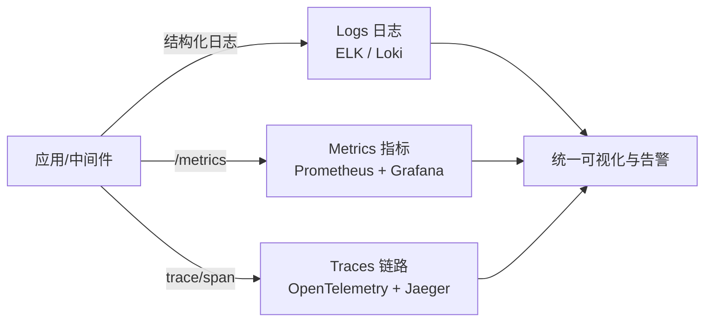
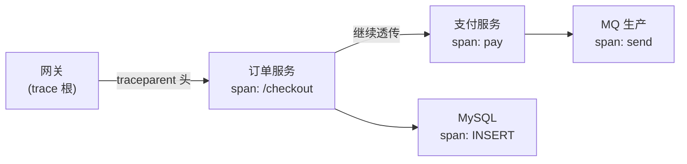

# 可观测性：日志、指标与链路追踪

> 系统上了 [K8s](./k8s.md) 之后，「出了问题不知道哪里坏了」才是最大痛点。可观测性（Observability）回答的是：**能不能仅凭系统对外输出的信息，快速定位内部发生了什么**。本文是 [Docker](./docker.md) → [K8s](./k8s.md) → [CI/CD](./ci-cd.md) 之后的运维收尾篇，AI 系统的专项实践见 [Agent 工程化](/blogs/ai-jobs/agent-03-engineering.md)。

---

## 1. 三支柱全景



| 支柱 | 回答的问题 | 特点 |
|------|-----------|------|
| **日志 Logs** | 事件的具体细节（错误堆栈、请求参数） | 离散、量大、逐条可读 |
| **指标 Metrics** | 系统健康度趋势（QPS、延迟、错误率） | 数值聚合、存储便宜、可告警 |
| **链路 Traces** | 一次请求跨了多少服务、时间花在哪 | 因果关系、跨服务串联 |

三者配合的标准打法：**告警看指标 → 定位看 trace → 取证看日志**。

---

## 2. 日志：从「print 大法」到结构化集中式

### 2.1 先把日志写对

```json
{"ts":"2026-10-30T21:00:00Z","level":"error","traceId":"a1b2c3","userId":"1001","event":"order_create_failed","orderId":"20261030001","err":"timeout: payment upstream"}
```

- **结构化（JSON）** 而非拼接字符串——机器可解析才有后续的一切
- **每条都带 traceId**（从请求上下文透传），这是日志与链路能关联的关键
- 分级克制：`error` 必须值得被呼叫；`warn` 可关注；`debug` 生产默认关
- **不打敏感信息**（密码/token/身份证）——日志一旦进采集系统就很难彻底删除
- 容器环境只写 **stdout**，落盘交给采集器（[Docker](./docker.md) 日志驱动），不要在容器里管理日志文件

### 2.2 采集与存储选型

| 方案 | 特点 | 适用 |
|------|------|------|
| **ELK/EFK**（Elasticsearch + Filebeat/Fluentd + Kibana） | 全文检索强、生态成熟 | 大团队、日志分析需求重 |
| **Loki + Promtail + Grafana** | 只索引标签不索引全文，**便宜**、与 Prometheus 同源 | K8s 中小团队首选 |
| 云服务（SLS/CLS/CloudWatch） | 免运维、按量付费 | 云上项目 |

---

## 3. 指标：Prometheus 体系

### 3.1 模型与四大黄金信号

Prometheus 采用**拉模型**：定时抓取各服务暴露的 `/metrics` 端点。指标三类：Counter（只增计数）、Gauge（瞬时值）、Histogram/Summary（分布与分位）。

监控什么？Google SRE 的**四大黄金信号**：

1. **延迟**：p95/p99 响应时间（平均数会骗人，一定看分位数）
2. **流量**：QPS / 连接数
3. **错误**：错误率、失败请求占比
4. **饱和度**：CPU/内存/队列积压/连接池占用

服务级指标用 **RED** 法（Rate、Errors、Duration），资源级用 **USE** 法（Utilization、Saturation、Errors）。

### 3.2 告警规则与纪律

```yaml
# Alertmanager 规则示例：错误率突增
- alert: HighErrorRate
  expr: sum(rate(http_requests_total{status=~"5.."}[5m])) by (service)
        / sum(rate(http_requests_total[5m])) by (service) > 0.02
  for: 5m
  labels: { severity: P1 }
```

告警三条纪律（违反就是「狼来了」）：

- **面向症状**告警（用户可感知的错误率/延迟），而不是面向原因（CPU 高就响）——原因类做成看板
- 每条 P0/P1 告警必须有**对应的处置动作**（runbook 链接）
- 定期清理「从来没人处理」的静默告警

### 3.3 SLO 与错误预算

给核心接口定 **SLO**（如「月度成功率 ≥ 99.9%」），1 - SLO 就是**错误预算**——预算烧完就该放缓发布、优先修稳定性，把「要不要稳」的争论变成数学题。K8s 层面的探针与资源看板见 [K8s 排障](./k8s.md)。

---

## 4. 链路追踪：跨服务的因果关系



- 一次请求 = 一个 **Trace**，内部每段工作 = **Span**（含耗时、标签、事件）
- 上下文通过 **W3C Trace Context** 标准 HTTP 头（`traceparent`）跨服务传递——自己造 traceId 头不如直接用标准
- **[OpenTelemetry（OTel）](https://opentelemetry.io/) 是事实标准**：一套 SDK/API 同时产出 traces/metrics/logs，后端可换（Jaeger/Tempo/SkyWalking/云 APM），避免绑定厂商
- 老项目埋点顺序：入口中间件先上（能看全链路拓扑）→ 数据库/外部调用 span → 抽样率调整（全量太贵，头部采样 + 错误全采样）
- **异步链路**：MQ 生产时把 trace 上下文放进消息头，消费端续上——否则异步任务在追踪图里断头，见 [消息队列](./mq.md) 的 traceId 实践

---

## 5. 前端也要可观测

| 项 | 工具 | 关注点 |
|----|------|--------|
| 错误监控 | **Sentry**（JS/小程序/App 全覆盖） | JS 异常、资源加载失败、接口错误 + sourcemap 还原 |
| 性能 | **Web Vitals**：LCP（加载）、INP（交互响应）、CLS（视觉稳定） | 真实用户数据（RUM）而非只在实验室测 |
| 行为 | 埋点/会话回放 | 转化漏斗、复现用户操作 |

前端错误上报记得带 release 版本号与 traceId（与后端串联），否则「用户白屏了」永远是悬案。

---

## 6. 检查清单

- [ ] 所有服务输出结构化 JSON 日志并携带 traceId
- [ ] 核心接口有 RED 看板 + 四大黄金信号，p99 可见
- [ ] 至少两条面向症状的 P1 告警（错误率、延迟）附 runbook
- [ ] OTel 接入入口服务，能从一条 URL 追到 DB 与下游调用
- [ ] 前端接入 Sentry + Web Vitals 上报
- [ ] 定过 SLO 吗？没有就先给最重要的一个接口定

> 延伸：[Docker](./docker.md) · [K8s](./k8s.md) · [CI/CD](./ci-cd.md) · [AI 系统可观测性](/blogs/ai-jobs/agent-03-engineering.md)
