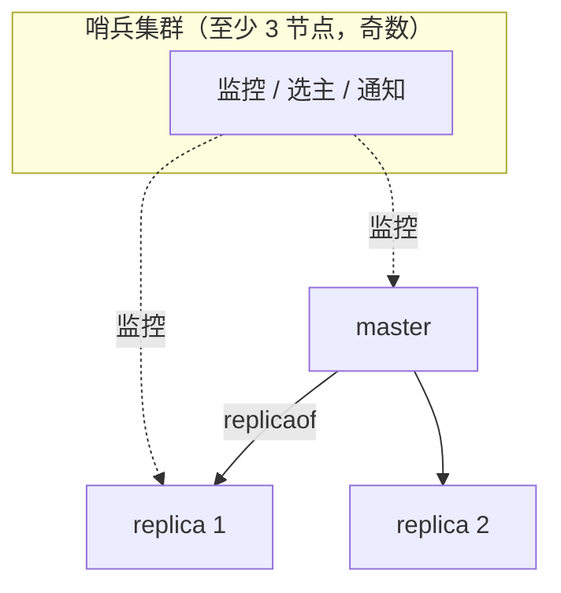

# Redis 核心知识体系

> 高性能内存数据库的完整主线：数据结构与场景、持久化、缓存三大问题、分布式锁、高可用架构。版本基线 **Redis 7.x**，文末附 2024–2026 许可证变更说明。

---

## 1. 为什么快

1. **内存操作** + 高效数据结构（SDS 动态字符串、跳表、压缩列表/listpack）
2. **单线程执行命令**：无锁、无上下文切换（6.0 起网络 IO 引入多线程，但**命令执行仍单线程**，原子性语义不变）
3. **IO 多路复用**（epoll）+ Pipeline 批量往返

---

## 2. 数据类型与真实场景

| 类型 | 底层结构（简） | 典型场景 |
|------|----------------|----------|
| String | SDS | 缓存对象 JSON、计数器（`INCR`）、分布式锁 |
| Hash | listpack / hashtable | 购物车（用户 ID → {商品: 数量}）、对象字段级读写 |
| List | quicklist（listpack 节点组成的双向链表；7.0 起 listpack 取代 ziplist） | 消息队列（LPUSH/BRPOP）、最新列表 |
| Set | intset / hashtable | 标签、共同关注（`SINTER`）、抽奖去重 |
| **ZSet** | listpack / **跳表 + 哈希表** | 排行榜（`ZRANGE`）、延迟队列（score 存执行时间） |
| Bitmap | String 位操作 | 签到（`SETBIT`）、活跃统计 |
| HyperLogLog | 概率结构 | 亿级 UV 估算（0.81% 标准差，固定 ~12KB） |
| GEO | ZSet 封装 | 附近的人（`GEOSEARCH`） |
| Stream | Radix 树 | 持久化消息队列、消费者组（对标 Kafka 的轻量方案） |

> 跳表是 ZSet 的灵魂：多层有序链表，平均 O(log N)，实现比平衡树简单且支持范围查询。

---

## 3. 持久化：RDB 与 AOF

| | RDB | AOF |
|--|-----|-----|
| 内容 | 某时刻全量二进制快照 | 每条写命令追加 |
| 触发 | `SAVE`/`BGSAVE`、配置的 save 点、主从全量同步时 | 每次写入；刷盘策略 `appendfsync`：`always` / `everysec`（默认，最多丢 1 秒）/ `no` |
| 实现 | **fork 子进程 + 写时复制（COW）** | 主进程追加到 aof_buf，后台 fsync |
| 恢复 | 快 | 重放（慢），AOF 重写（bgrewriteaof）压缩体积 |
| 风险 | 崩溃丢失上次快照后的数据 | 文件大、恢复慢 |

**4.0+ 混合持久化**（`aof-use-rdb-preamble`）：重写时 RDB 做前缀全量 + 增量 AOF 追加，恢复快、丢失少，生产默认推荐。

---

## 4. 过期与内存淘汰

- **过期策略**：惰性删除（访问时检查）+ 定期删除（后台周期抽样清理）
- **内存淘汰**（`maxmemory` 触发后，8 种策略）：
  - `noeviction`（默认，写报错）
  - `allkeys-lru` / `volatile-lru`（最久未用）
  - `allkeys-lfu` / `volatile-lfu`（4.0+，访问频率，适合有周期热点的场景）
  - `allkeys-random` / `volatile-random` / `volatile-ttl`
- **主从下删除同步**：主库删除后向从库传播 `DEL`，从库不主动过期——读从库可能读到已过期数据（3.2+ 读时会判断逻辑过期）

---

## 5. 缓存三大问题（必考）

| 问题 | 定义 | 方案 |
|------|------|------|
| **穿透** | 查询**不存在**的数据，每次都打到 DB | ① 空值缓存（短 TTL）② **布隆过滤器**前置（可能误判存在，绝不误判不存在）③ 入参校验 |
| **击穿** | 某个**热点 key 过期瞬间**，大量请求同时打到 DB | ① 互斥锁重建（拿锁的一个请求查库回填）② 逻辑过期（不设 TTL，值里带过期时间，异步刷新）③ 热点永不过期 |
| **雪崩** | **大量 key 同时过期**或 Redis 宕机 | ① TTL 加随机抖动 ② 多级缓存（本地 + Redis）③ 高可用集群 ④ 限流降级兜底 |

一致性套路（Cache-Aside）：**读**：先缓存，未命中查库回填；**写**：先更新 DB，**再删缓存**（而非更新缓存，避免并发写覆盖与冷数据浪费）。要求更强则延迟双删 / 订阅 binlog（Canal）异步删除。

---

## 6. 分布式锁（细节都是坑）

```sh
# 加锁：NX（不存在才设）+ EX（原子设置过期）+ 唯一值（防误删）
SET lock:order:1001 <uuid> NX EX 10
# 释放必须用 Lua 保证「判断是自己 + 删除」原子性
```

```lua
if redis.call("GET", KEYS[1]) == ARGV[1] then
  return redis.call("DEL", KEYS[1])
else
  return 0
end
```

必须想清楚的四个问题：

1. **锁过期但业务没执行完** → 看门狗续期（如 Redisson 的 watchdog）
2. **主从切换锁丢失**（主库写入锁未同步即宕机）→ Redlock（多节点多数派）。⚠️ 准确表述：Redlock 的安全性存在著名争议（Martin Kleppmann 与 antirez 的公开辩论），强一致要求高的场景建议改用 ZooKeeper/etcd 或把互斥收敛到 DB 唯一约束
3. **可重入** → Hash 结构记持有者与重入次数（Redisson 已实现）
4. ** fencing token**：下游用递增令牌拒绝旧持有者的迟到写入

---

## 7. 高可用：主从 → 哨兵 → 集群



- **主从复制**：全量（BGSAVE + RDB 传输）+ 增量（replication backlog 缓冲区断线续传，`replid + offset`）
- **哨兵 Sentinel**：监控 + 多数派判定客观下线 + Raft 式选领导者执行故障转移 + 通知客户端新地址
- **Cluster 集群**：
  - **16384 个哈希槽**，`CRC16(key) % 16384` 分配到节点；节点间 gossip 协议通信
  - 客户端收到 `MOVED` 重定向（智能客户端本地缓存槽位表）；迁移中用 `ASK`
  - **多 key 操作要求同槽**：用 hash tag `{user1001}.orders` 强制同槽
  - 每个主节点配至少一个从节点，主故障时从节点自动升主

---

## 8. 实战避坑清单

- [ ] **大 key**（String > 10KB、集合元素 > 数千）：拆分、压缩、`UNLINK` 异步删除（4.0+ lazy free）
- [ ] **热 key**：本地缓存一层、key 加随机后缀分散、读写分离
- [ ] `KEYS *` 生产禁用 → 用 `SCAN`（游标遍历，不阻塞）
- [ ] 复杂原子逻辑用 **Lua 脚本**（`EVAL`）；`MULTI/EXEC` 事务不回滚，只保证入队执行
- [ ] Pipeline 与事务区别：Pipeline 只省往返 RTT，不保证原子
- [ ] O(1) 判断之外，`ZRANGE`、`LRange` 等注意传 limit，别一次拉全量

---

## 9. 版本与许可证（2024–2026 重要变化）

- Redis 7.4 起采用 RSALv2/SSPL 双许可（非 OSI 开源定义），引发社区分叉
- **Valkey**（Linux 基金会，从 Redis 7.2.4 fork）成为主流替代，各大云厂商跟进
- Redis 8（2025.5）重新加入 AGPLv3 许可选项，并内置部分数据结构（JSON/时序/概率）——选型时确认你所用云服务/发行版对应的许可与版本

> 延伸：[MySQL](./mysql.md) · [MongoDB](./mongodb.md) · [Docker](./docker.md) · [消息队列](./mq.md)
