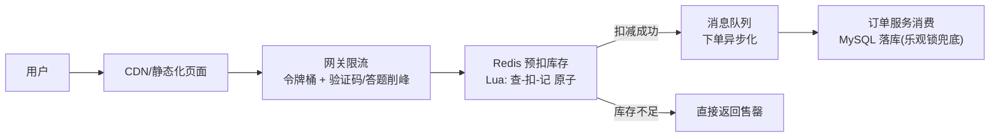

# 经典系统设计题：短链、秒杀、Feed 流与分布式 ID

> 系统设计题考的不是背答案，而是**权衡能力**。本文给出通用答题框架 + 四道高频题的参考设计，每道题都标注用到的组件——[MySQL](./mysql.md)、[Redis](./redis.md)、[消息队列](./mq.md)、[K8s](./k8s.md) 的知识在这里合流。面试现场版框架另见 [C.A.S.E. 框架](/blogs/ai-jobs/fde-04-interview.md)。

---

## 0. 通用答题框架（先背这个）

```text
1. 澄清需求    功能边界？QPS/数据量级？读写比？一致性要求？
2. 粗略估算    存储量 = 写 QPS × 大小 × 保留期；带宽；缓存命中率假设
3. API 与数据模型  核心接口签名 + 表结构（够用即可）
4. 画出架构    客户端 → 网关/负载均衡 → 服务 → 缓存 → DB → MQ
5. 深入难点    面试官会追问的点：热点、一致性、扩展性、故障
6. 权衡与演进  「如果 QPS ×10 怎么办」「牺牲什么换什么」
```

最常见的挂法：**没澄清就开始画**、只说组件名不谈权衡、从不提故障与兜底。

---

## 1. 短链系统（设计感最强的一题）

**需求澄清**：读多写少（读写比 100:1）？需要统计点击量吗？自定义域名/短码？有效期？

### 短码生成三条路线

| 方案 | 做法 | 权衡 |
|------|------|------|
| **发号器 + Base62**（推荐） | 分布式自增 ID → 62 进制编码（`a1Z9`） | 无冲突、短、可预测（需防遍历：加随机位或鉴权） |
| Hash 截断（MD5/Murmur 前 7 位） | 冲突需再探测 | 实现简单但冲突处理烦 |
| 预生成号池 | 提前生成随机码入 [Redis](./redis.md) Set，用即取 | 无规律难遍历，需要补货机制 |

### 关键设计点

- **302 还是 301**：301 永久重定向会被浏览器缓存——省流量但**统计不到点击**；需要统计用 302
- **读路径**：`短码 → Redis 缓存 → MySQL`（长 URL 映射表：短码唯一索引 + 原始 URL）。热点短码本地缓存再兜一层
- **不存在的短码**会被恶意高频打 DB → [布隆过滤器](./redis.md)前置（同缓存穿透问题）
- **点击统计**：同步计数是热点瓶颈 → 异步：Redis `INCR` 聚合 + 定时落库，或投递到 [Kafka](./mq.md) 批处理
- 量级参考：1 亿条映射 × 每条 ~100B ≈ 10GB，单表分 ShardingKey=短码 hash 即可，**这题的难点在缓存与统计，不在存储**

---

## 2. 秒杀系统（流量工程集大成）

**需求澄清**：库存量级？能超卖吗（不能）？一人几件？允许排队到「稍后告知」吗？



分层挡流量，**每一层都要过滤掉一大批**：

1. **前端/CDN**：页面静态化 + 按钮置灰 + 答题/验证码打散请求
2. **网关**：令牌桶限流、UID/设备维度频控、黑名单
3. **Redis 预扣**：库存预热到 Redis；**Lua 脚本**把「查库存 → 扣减 → 记录用户」做成原子操作，天然防超卖；售罄后直接拒绝，请求不再往下走
4. **MQ 异步落库**：预扣成功发消息，订单服务匀速消费写 MySQL；DB 层 `stock > 0` 乐观锁作**最后防线**（Redis 与 DB 双保险）
5. **一致性收尾**：支付超时未付 → 延迟消息回滚库存（[延迟消息](./mq.md)）

防刷补充：同一 UID 重复下单直接拒；风控维度（设备/IP/行为）前置；**对账任务**兜底 Redis 与 DB 的库存差异。

---

## 3. Feed 流：推模式 vs 拉模式

**场景**：关注流（微博/Twitter/朋友圈）怎么把「我关注的人的最新内容」聚合出来？

| 模式 | 做法 | 优点 | 缺点 |
|------|------|------|------|
| **推（写扩散）** | 发博时写入每个粉丝的收件箱（Redis ZSet） | 读极快（直接读自己的箱子） | **大 V 发博写 3000 万份**，写爆炸 |
| **拉（读扩散）** | 读时聚合关注者最新 N 条 | 写简单、无扩散成本 | 读慢（聚合多人查询），大 V 读延迟敏感 |
| **推拉结合**（主流） | 普通用户推；**大 V 只推给活跃粉丝，其余读时拉**；读时合并去重 | 平衡读写 | 实现复杂，需要在线状态/粉丝活跃度判断 |

工程细节：收件箱用 ZSet（score=时间戳）只保留最近 N 条；分页用游标（上次刷到的 score）而不是 OFFSET；删除/审核内容要能从所有收件箱撤下（记 content_id，展示时校验状态）。

---

## 4. 分布式 ID：分库分表后的身份证

| 方案 | 原理 | 权衡 |
|------|------|------|
| UUID v4 | 随机 128 位 | 无序 → InnoDB 页分裂严重，**别做主键**；太长 |
| 数据库号段 | 每次从 DB 批量取一段（如 1 万个）缓存在内存 | 简单可靠；实例重启浪费段、短暂重复风险需运维约定 |
| **雪花算法 Snowflake** | 时间戳(41bit) + 机器 ID(10bit) + 序列(12bit)，趋势递增 | 高性能最常用；**时钟回拨**要处理（等待/抛错/备用位）；机器 ID 分配需协调 |
| Redis `INCR` | 原子自增 | 强依赖 Redis 可用性 |

选型口诀：**单体别折腾（自增够用）；分库分表用雪花或号段；对外开放的编号（订单号）不要暴露业务量 → 加随机盐位**。

---

## 5. 更多高频场景速览

| 场景 | 核心方案 |
|------|----------|
| 排行榜 | Redis ZSet（实时），亿级用户分层（前 1 万 ZSet + 其余落库估算） |
| 延迟任务 | Redis ZSet 轮询 / RocketMQ 延迟消息 / 时间轮 |
| 附近的人 | Redis GEO（底层 ZSet + geohash） |
| 点赞/计数 | Redis 计数 + 定时批量落库；防刷按 UID 去重 |
| 读写分离下的一致性 | 写后读走主库（粘性）/ GTID 等位点，见 [MySQL 主从](./mysql.md) |
| 缓存与 DB 一致性 | Cache-Aside + 延迟双删 / binlog 订阅异步删，见 [Redis 缓存三大问题](./redis.md) |

---

## 6. 答题时的加分动作

- [ ] 主动给数字：先估算再设计（哪怕粗略），QPS 决定架构层次
- [ ] 每个组件选择说一句「为什么不选另一个」
- [ ] 至少主动提两次**故障**：Redis 挂了怎么办？MQ 积压怎么办？
- [ ] 结尾给演进路线：「现在这样够用，QPS 到 X 时先加缓存再拆服务」

> 延伸：[Redis](./redis.md) · [消息队列](./mq.md) · [MySQL](./mysql.md) · [可观测性](./observability.md) · [FDE 面试通关](/blogs/ai-jobs/fde-04-interview.md)
