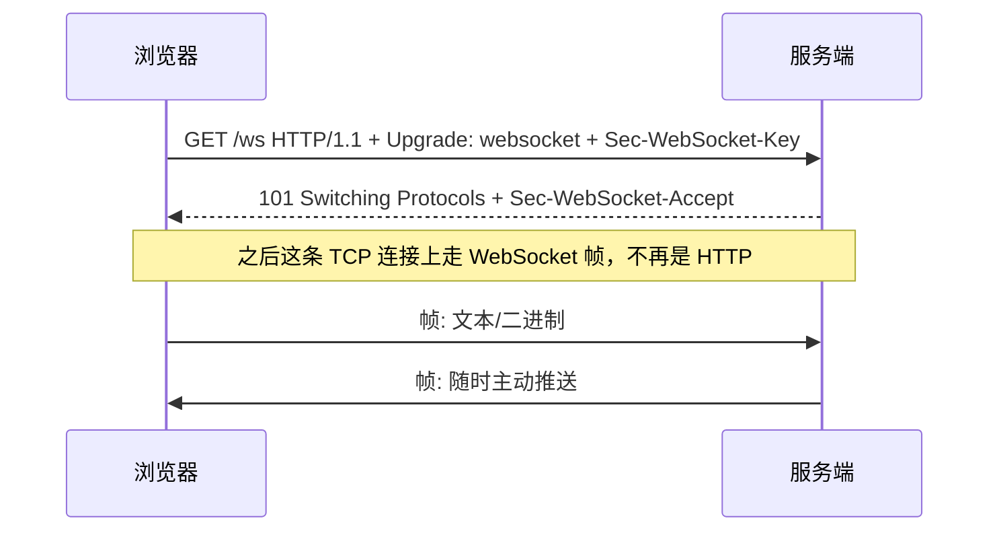

# 实时通信：WebSocket、SSE 与选型

> 聊天室、协作文档、行情推送、AI 流式回答——凡是「服务端主动说话」的场景都归这篇管。主线：为什么 HTTP 不够 → 四种方案对比 → WebSocket 工程化 → 服务端扩展与安全。

---

## 1. 为什么普通 HTTP 不够

HTTP 的请求-响应模型里，**服务端永远是被动的**：客户端不问，服务端不能说。想「实时」，只能在四个方案里选：

| 方案 | 原理 | 双向 | 代价/局限 |
|------|------|------|-----------|
| 短轮询 | 定时发请求问「有新的吗」 | ❌ | 延迟高、大量无效请求 |
| 长轮询 | 请求挂住直到有数据再返回 | ❌（伪） | 每次都重建连接，服务端挂连接资源 |
| **SSE** | HTTP 长连接，服务端单向持续推流 | ❌（单向） | 只能文本、需 HTTP/1.1 下注意连接数限制 |
| **WebSocket** | 升级为全双工 TCP 长连接（RFC 6455） | ✅ | 需要单独的协议处理、扩容要考虑有状态 |

一句话选型：**只下行（服务端 → 客户端）用 SSE，双向交互用 WebSocket**。

---

## 2. WebSocket 核心机制

### 2.1 握手与通信



- 浏览器 API 极简：`new WebSocket(url)` + `onopen/onmessage/onclose/onerror`，`send()` 发文本或二进制
- **心跳**：网络设备会掐空闲长连接，需定期 ping/pong（协议层帧或应用层消息）；多久发一次没有标准，30–60s 常见
- **断线重连**：浏览器**不会**自动重连——指数退避 + 抖动的重连器要自己写（或用封装库）；重连后注意**补偿拉取**（断线期间漏掉的数据，用 lastEventId/序号补）

### 2.2 Node 服务端最小示例

```js
import { WebSocketServer } from 'ws'

const wss = new WebSocketServer({ port: 8080 })

wss.on('connection', (socket, req) => {
  // 1. 鉴权：解析 Cookie/Header 里的凭证，失败立刻 close
  // 2. 心跳
  socket.isAlive = true
  socket.on('pong', () => (socket.isAlive = true))

  socket.on('message', (data) => {
    // JSON 解析 + 校验 + 业务处理；异常消息直接回错误帧而不是崩
  })
})

// 定期清理死连接
setInterval(() => {
  wss.clients.forEach((socket) => {
    if (!socket.isAlive) return socket.terminate()
    socket.isAlive = false
    socket.ping()
  })
}, 30_000)
```

封装库选择：**ws**（薄、可控）vs **Socket.IO**（自带重连、房间 rooms、降级轮询、广播 API，代价是多一层协议与包体）。前端原生 API 不够用时 Socket.IO 是务实之选。

---

## 3. 服务端扩展：有状态的连接怎么横向扩

WebSocket 连接是**有状态**的（用户 A 的连接固定在某台实例上），扩容多实例后两个问题：

1. **粘性会话（sticky session）**：握手升级后的连接必须留在同一实例，负载均衡器要按 IP/Cookie 亲和（或用支持长连接的网关）
2. **跨实例广播**：A 连在节点 1，要收的消息产生在节点 2 —— 用 **Redis Pub/Sub**（或专门的消息队列）做实例间事件总线，每台订阅后推给本机连接

```text
客户端 ──ws──▶ 节点1 ─┐
客户端 ──ws──▶ 节点2 ─┼── 订阅/发布 ──▶ Redis Pub/Sub（业务事件总线）
客户端 ──ws──▶ 节点3 ─┘
```

连接数上限本质是**内存与文件描述符**，单机数十万连接可行；再往上考虑专门的推送网关/云服务。

---

## 4. SSE：被低估的单向流

```js
// 服务端（任何能返回 HTTP 响应的框架都行）
res.writeHead(200, {
  'Content-Type': 'text/event-stream',
  'Cache-Control': 'no-cache',
  Connection: 'keep-alive',
})
res.write(`id: 42\n`)
res.write(`event: message\n`)
res.write(`data: {"text":"hello"}\n\n`)   // 空行分隔事件

// 浏览器：EventSource 自带重连，重连时带 Last-Event-ID 头
const es = new EventSource('/stream')
es.onmessage = (e) => console.log(e.data)
```

- 纯 HTTP：不用换协议、网关/代理天然友好、断线重连与续传（Last-Event-ID）是**协议内置**的
- 局限：单向、默认只传 UTF-8 文本、HTTP/1.1 下浏览器对同域有 6 连接限制（HTTP/2 多路复用后解除）
- **明星场景：LLM 流式输出**——OpenAI/Anthropic 等家 API 的 stream 模式都是 SSE，自己实现聊天界面同理。这也解释了为什么 [Agent 工程化](/blogs/ai-jobs/agent-03-engineering.md)里流式 UI 是前端标配

---

## 5. 反向代理与安全

### Nginx 代理 WebSocket 的关键三行

```nginx
location /ws {
  proxy_pass http://backend;
  proxy_http_version 1.1;
  proxy_set_header Upgrade $http_upgrade;      # 没有这两行握手必失败
  proxy_set_header Connection "upgrade";
  proxy_read_timeout 3600s;                    # 长连接别被默认 60s 掐断
}
```

SSE 注意关闭缓冲（`proxy_buffering off` 或响应头 `X-Accel-Buffering: no`），否则事件会被攒着一起发。

### 安全清单

- [ ] **校验 Origin**：握手阶段拒绝跨站连接（WebSocket 不受同源策略保护！）
- [ ] 鉴权走 Cookie/Header；如果只能放 URL query（浏览器 WebSocket API 不能自定义头），用一次性短时 ticket 换连接，避免长期 token 进访问日志
- [ ] 消息格式与大小限制、发送频率限制（防滥用与 DoS）
- [ ] wss://（TLS）必须；下行内容同样要做权限过滤——**推错人比拉错更严重**

---

## 6. 选型决策树

```text
需要服务端主动推送吗？
├─ 不需要 → 普通 HTTP
└─ 需要
    ├─ 只下行、文本流、想最简单 → SSE
    ├─ 双向、低延迟、消息语义复杂 → WebSocket（ws / Socket.IO）
    └─ 海量设备、弱网、到达率敏感 → 考虑云推送服务 / MQTT
```

> 延伸：[Nginx](./Nginx.md) · [Redis Pub/Sub](./redis.md) · [Agent 流式前端](/blogs/ai-jobs/agent-03-engineering.md) · [认证与鉴权](./auth.md)
