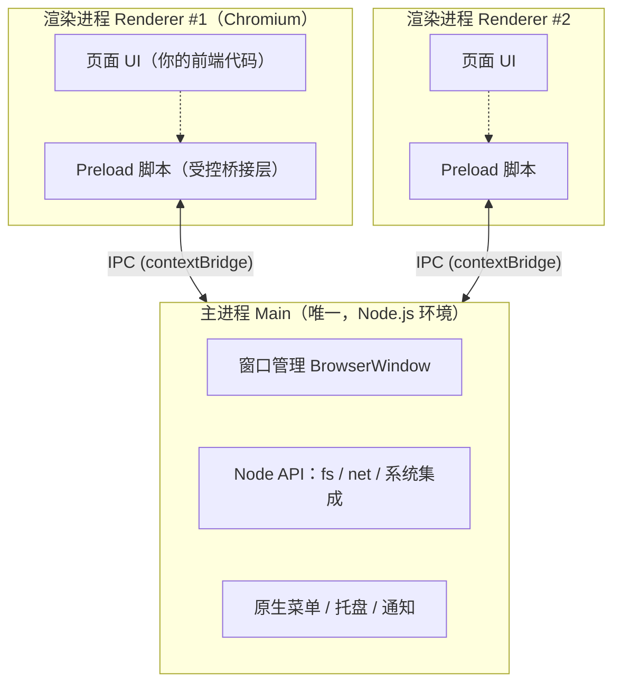

# Electron：架构、进程模型与安全实践

> Electron = **Chromium（渲染）+ Node.js（系统能力）+ 原生壳**。VS Code、Slack、Figma 桌面版都基于它。本文覆盖架构、IPC、安全模型、打包与自动更新，并在文末给出与 [Tauri](./tauri.md) 的选型对照。

---

## 1. 进程模型（必须先建立的心智图）



- **主进程**：应用入口（`main.js`），每个应用**只有一个**。管理窗口生命周期、原生 API、系统托盘、菜单；可完整使用 Node.js。
- **渲染进程**：每个 `BrowserWindow` 一个，就是一个 Chromium 页面。跑你的前端应用（React/Vue 打包产物）。
- **Preload 脚本**：渲染进程启动前运行的桥接层，是**唯一**被设计为「安全暴露系统能力」的地方——通过 `contextBridge` 把白名单方法挂到 `window` 上。

> 渲染进程崩了可以只重开窗口；主进程崩了整个应用退出——所以重活、阻塞操作放子进程或 worker，别卡主进程。

---

## 2. IPC：渲染进程怎么安全地用系统能力

现代 Electron 的标准姿势是 **`invoke / handle`（promise 风格）**：

**主进程** `main.js`：

```js
const { app, BrowserWindow, ipcMain } = require('electron')
const path = require('node:path')

function createWindow() {
  const win = new BrowserWindow({
    width: 960,
    height: 640,
    webPreferences: {
      preload: path.join(__dirname, 'preload.js'),
      // 下面两项新版本默认就是安全的取值，显式写出以防被改
      contextIsolation: true,
      nodeIntegration: false,
    },
  })
  win.loadFile('dist/index.html') // 或 loadURL('http://localhost:5173') 开发态
}

ipcMain.handle('read-config', async (event, name) => {
  // 参数校验！渲染进程的一切输入都不可信
  if (typeof name !== 'string' || !/^[\w-]+\.json$/.test(name)) {
    throw new Error('invalid config name')
  }
  return app.getPath('userData') + '/' + name
})

app.whenReady().then(createWindow)
```

**Preload** `preload.js`：

```js
const { contextBridge, ipcRenderer } = require('electron')

contextBridge.exposeInMainWorld('native', {
  readConfig: (name) => ipcRenderer.invoke('read-config', name),
  // 只暴露白名单方法，绝不暴露 ipcRenderer 本身
})
```

**渲染进程**（你的 React/Vue 代码）：

```js
const cfg = await window.native.readConfig('settings.json')
```

其余通信方式：`webContents.send`（主 → 渲染推送）、`ipcRenderer.on`（渲染侧订阅）、`MessagePort`（大数据量/高频场景，点对点通道）。

---

## 3. 安全模型（面试与事故高发区）

Electron 应用 = 一个能读写磁盘的网页，安全默认值必须守住：

| 配置 | 取值 | 原因 |
|------|------|------|
| `contextIsolation` | `true`（v12 起默认） | 隔离 preload 与页面世界，防止页面篡改桥接层 |
| `nodeIntegration` | `false`（默认） | 渲染进程拿到 Node = XSS 即 RCE |
| `sandbox` | `true`（v20 起渲染进程默认） | 限制渲染进程的系统能力 |
| `webSecurity` | 保持 `true` | 关掉等于裸奔跨域 |

**核心原则**：渲染进程当作「不可信的浏览器页面」对待——远程内容加载进 `BrowserWindow` 时尤其如此。所有系统能力经 preload 白名单 + 主进程参数校验。历史上多起 Electron 应用 RCE 都源于 `nodeIntegration: true` + 加载远程内容。

其他要点：

- **导航劫持**：`will-navigate` / `setWindowOpenHandler` 里限制窗口只能导航到自己的域名
- **CSP**：生产环境给页面配 Content-Security-Policy
- **证书**：监听 `certificate-error`，不要无脑 `event.preventDefault()`

---

## 4. 打包、更新与跨平台

| 事项 | 方案 |
|------|------|
| 打包 | `electron-builder`（常用，配置化）或 `electron-forge`（官方） |
| 产物 | Windows：NSIS 安装包 / portable；macOS：dmg（签名 + 公证）；Linux：AppImage / deb |
| 自动更新 | `electron-updater`（配合自建或 GitHub Releases）；macOS 强制要求签名才可更新 |
| 原生模块 | 用 N-API（`node-gyp` 编译）的模块需按平台重编；能用纯 JS 实现就别用 native |
| 裁剪体积 | `files` 白名单只打必要文件；排除 `devDependencies`；双 `package.json` 结构可选 |

典型 CI：GitHub Actions 矩阵构建三平台，macOS 记得配证书 + `notarize`（公证）。

---

## 5. 性能与体验要点

- **窗口冷启动**：`show: false` + `ready-to-show` 再显示，避免白屏；启动慢先查主进程同步 IO
- **内存**：每个渲染进程都是完整 Chromium 环境，多窗口场景考虑 `BrowserWindow` 复用或单窗口多视图（`WebContentsView`）
- **大文件/重计算**：放 `utilityProcess`（Node 子进程）或 worker，主进程只做调度
- **托盘/全局快捷键/开机自启**：都有官方 API，注意 macOS 与 Windows 的行为差异（如托盘在 macOS 是菜单栏）

---

## 6. Electron vs Tauri 怎么选

| 维度 | Electron | Tauri 2.x |
|------|----------|-----------|
| 渲染 | 自带 Chromium，各平台一致 | 系统 WebView，老系统可能有兼容坑 |
| 后端 | Node.js | Rust（也可 sidecar 调任意语言二进制） |
| 体积 | 80–150MB 起 | 5–20MB |
| 移动端 | 无 | iOS / Android |
| 生态 | 最成熟，疑难杂症都有答案 | 快速成长，官方核心插件齐全 |

一句话：**纯前端团队、要一致的渲染、重度依赖 npm 原生生态 → Electron；在意体积/内存、接受 Rust、要多端 → Tauri**。两家共同的安全关键词：进程隔离 + IPC 白名单 + 最小权限。

---

## 7. 读完马上做

- [ ] 用官方脚手架起一个最小应用，走通 `invoke/handle` + `contextBridge` 全链路
- [ ] 把 `nodeIntegration` 打开的旧项目列出来，迁移到 preload 白名单方案
- [ ] 接入 `electron-updater`，走一遍「发版 → 客户端收到更新」流程
