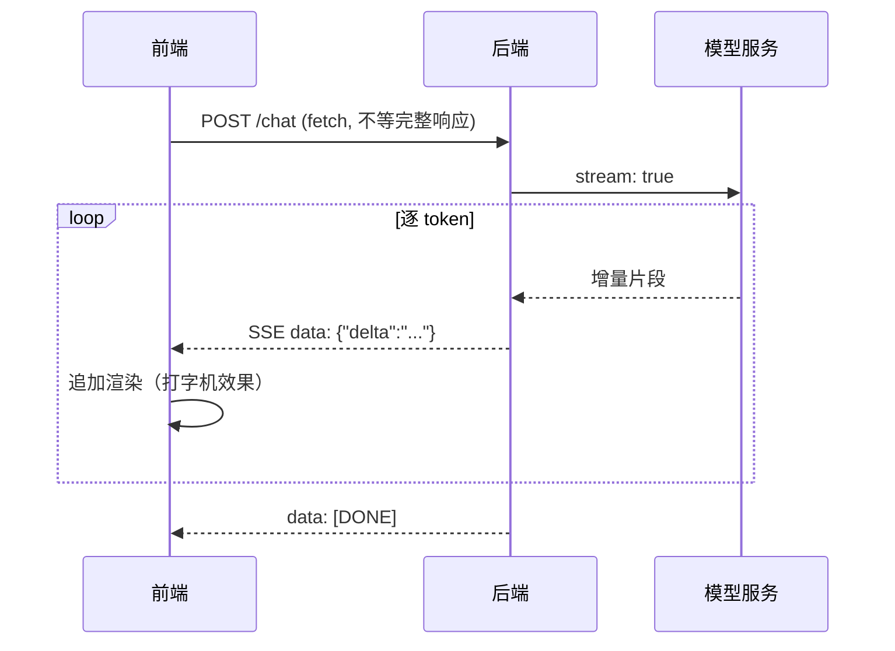

# AI 产品前端开发指南：流式、对话 UI 与 Copilot 交互

> 大模型把「前端」的边界拓宽了：响应不再是一次性 JSON，而是一个逐字吐出的流；界面不再是表单列表，而是对话、草稿与工具调用可视化。本文讲清 AI 产品前端的工程要点，是 [实时通信](/blogs/backend/websocket.md)（SSE 原理）与 [Agent 工程化](/blogs/ai-jobs/agent-03-engineering.md)（系统侧）的前端视角。

---

## 1. 核心：流式渲染（一切体验的基础）



**两种流协议的前端接入**：

```js
// 方式一：SSE（GET/标准 EventSource）——最简单
const es = new EventSource('/chat?msg=hi')
es.onmessage = (e) => appendDelta(JSON.parse(e.data).delta)

// 方式二：POST + fetch 流式读取（更常用：要发大 body、自定义头）
const res = await fetch('/chat', { method: 'POST', body })
const reader = res.body.getReader()
const decoder = new TextDecoder()
let buffer = ''
while (true) {
  const { done, value } = await reader.read()
  if (done) break
  buffer += decoder.decode(value, { stream: true })
  // SSE 按 \n\n 分帧；缓冲区里可能有不完整帧，切完留尾巴
  const frames = buffer.split('\n\n')
  buffer = frames.pop()
  for (const frame of frames) {
    const data = frame.replace(/^data: /, '')
    if (data === '[DONE]') return
    appendDelta(JSON.parse(data).delta)
  }
}
```

必须踩对的三个坑：

1. **帧边界**：网络分片可能把一条 SSE 消息切成两半——必须用缓冲区攒帧（上面 `buffer` 的写法），直接 `JSON.parse(chunk)` 会在高负载时随机炸
2. **中断**：用 `AbortController` 让用户随时停止生成（`reader.cancel()` + 后端联动取消 LLM 请求，**省钱**）
3. **flush**：后端要关代理缓冲（[Nginx `proxy_buffering off`](/blogs/backend/websocket.md)），否则「流式」变成一次性吐完

---

## 2. 打字机效果与 Markdown 渐进渲染

- **别逐字符 setTimeout**——直接按到达节奏追加即可，LLM 的吐字本身就是天然打字机；觉得太快可以做个「追赶动画」（渲染速度略低于到达速度，队列消费）
- **Markdown 流式渲染的难题**：半截的 `**粗体`、未闭合的 ```` ``` ```` 代码块都会渲染错乱。实用策略：
  - 每帧对「未闭合语法」做修补：代码块自动补 \`\`\`、配平 `*`/`_`/括号，再交给 marked/markdown-it
  - 或渲染「已确认完成」的段落 + 最后一段纯文本流式（多数用户感知不到差异）
- **代码块高亮**：流式期间低频重高亮（节流 200ms）+ 流结束后精修一次，避免每 token 全量 highlight 的性能坑
- 数学公式/表格同理：完成前降级为纯文本

---

## 3. 对话 UI 的模式库

| 模式 | 设计要点 |
|------|----------|
| **消息流** | 用户/AI 消息左右或上下区分；AI 消息必备「重新生成 / 复制 / 点赞点踩」三件套 |
| **过程可视化** | 「正在检索知识库… → 调用工具 getWeather → 生成回答」，把 Agent 的中间步骤展示出来——**透明度直接决定信任度** |
| **引用与溯源** | 答案旁挂来源卡片（点击跳原文片段），对抗幻觉质疑的第一 UX，见 [RAG 实战](/blogs/ai-jobs/agent-05-rag.md) |
| **草稿模式（HITL）** | AI 产出建议 → 人编辑确认 → 生效；配 diff 对比视图（邮件/合同/PR 描述场景） |
| **参数化生成** | 侧边栏暴露 temperature/模型/知识库范围，但**默认全收起**——高级用户才展开 |
| **长对话管理** | 会话列表 + 历史摘要折叠；上下文超限时提示「开新会话」，见 [上下文工程](/blogs/ai-jobs/agent-02-core.md) |

**状态机思维**：一个 AI 消息的生命周期是 `pending → streaming → done | aborted | error`，用显式状态机管理（而不是一堆布尔值），重连/重试/中断才不会写出面条代码。断线恢复见 [实时通信的补偿拉取](/blogs/backend/websocket.md)。

---

## 4. 工具生态：别重复造轮子

| 场景 | 推荐 | 说明 |
|------|------|------|
| React/Next 全家桶 | **Vercel AI SDK**（`useChat`/`useCompletion`） | 流式、partial JSON、工具调用 UI 的 hooks 封装，事实标准 |
| Vue | ai-sdk 的 Vue 适配或自写 composable | 心智同上 |
| 富编辑器内嵌 AI | Tiptap/ProseMirror 插件化 | 文档内「选中文本改写」的 copilot 形态 |
| 结构化流（表单/卡片） | partial JSON 解析器 | 流式输出 JSON 时边到达边渲染卡片骨架 |

自研判断标准：如果产品只是「一个聊天框」，SDK 直接上；如果有深度定制的交互（多 Agent 视图、画布、表格编辑），hooks 层自己写、协议仍用 SSE。

---

## 5. 性能与体验清单

- [ ] 流式渲染用 `requestAnimationFrame` 批量刷 DOM，别每 token 一次 `setState`（长回答会卡）
- [ ] 虚拟列表：百条以上消息的会话做滚动虚拟化
- [ ] 打字期间禁用发送按钮、保留**停止**按钮（最常用也最常被忘记的按钮）
- [ ] 错误态可重试：网络断/超时给出「重试本条」，不丢已生成内容
- [ ] 首帧要快：用户发出后**立即**渲染「思考中」占位与骨架，等待模型首 token（可能 1–3s）
- [ ] 移动端：键盘弹起时输入框跟随、长回答折叠 + 展开全文
- [ ] 埋点：首 token 延迟（TTFT）、完整回答时长、重试率/采纳率——这些就是前端的「Eval」，见 [Agent 评测](/blogs/ai-jobs/agent-03-engineering.md)

---

## 6. 读完马上做

- [ ] 用 `fetch` + reader 手写一遍 SSE 解析（含帧缓冲），别只用 EventSource
- [ ] 给流式 Markdown 加未闭合语法修补，对比修复前后的渲染错乱率
- [ ] 实现一次完整的中断 → 恢复流程（AbortController + 服务端取消）

> 延伸：[SSE 与 WebSocket 原理](/blogs/backend/websocket.md) · [Agent 工程化](/blogs/ai-jobs/agent-03-engineering.md) · [RAG 实战](/blogs/ai-jobs/agent-05-rag.md)
