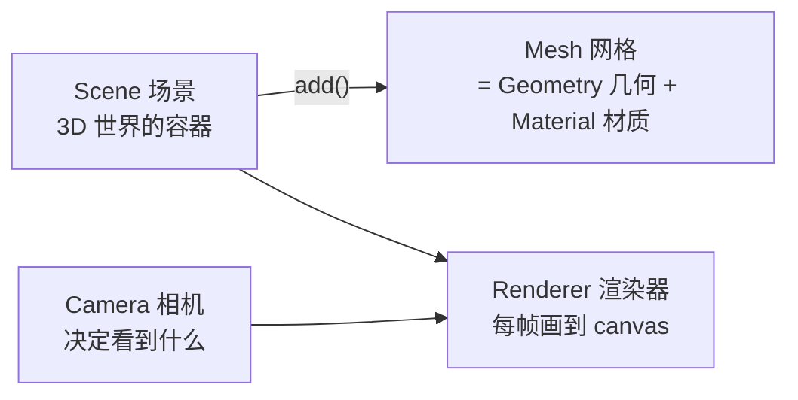

# Three.js：从入门到可交付

> Three.js 把 [WebGL](./webgl.md) 的渲染管线封装成场景图 API，让前端工程师不用手写 GLSL 矩阵就能做 3D。本文走「核心三件套 → 材质与光照 → 模型加载 → 交互 → 性能优化」主线，代码基于现代 ESM 版本（r160+）。

---

## 1. 心智模型：三个必须先立住的概念



- **Scene**：场景图（scene graph），对象以树组织，父对象的变换会传递给子对象
- **Camera**：`PerspectiveCamera`（透视，近大远小，最常用）与 `OrthographicCamera`（正交，工程图纸/2.5D）
- **Renderer**：`WebGLRenderer` 主力；`WebGPURenderer` 是新一代方向（以实验特性迭代多年，近期版本逐渐稳定，暂不必作为默认）

坐标系：右手系，Y 向上；相机默认看向 -Z 方向。单位没有规定，**团队自己定 1 单位 = 1 米**并全项目遵守，否则灯光衰减和物理参数会乱。

---

## 2. 最小可运行示例（无需构建工具）

```html
<!DOCTYPE html>
<html>
<head>
  <meta charset="utf-8" />
  <style> body { margin: 0; overflow: hidden; } </style>
</head>
<body>
<script type="importmap">
  { "imports": { "three": "https://unpkg.com/three@0.170.0/build/three.module.js",
                 "three/addons/": "https://unpkg.com/three@0.170.0/examples/jsm/" } }
</script>
<script type="module">
  import * as THREE from 'three'
  import { OrbitControls } from 'three/addons/controls/OrbitControls.js'

  // 1. 场景
  const scene = new THREE.Scene()
  scene.background = new THREE.Color(0x0b0e1a)

  // 2. 相机：(视野角FOV°, 宽高比, 近平面, 远平面)
  const camera = new THREE.PerspectiveCamera(60, innerWidth / innerHeight, 0.1, 100)
  camera.position.set(3, 3, 5)

  // 3. 渲染器
  const renderer = new THREE.WebGLRenderer({ antialias: true })
  renderer.setSize(innerWidth, innerHeight)
  renderer.setPixelRatio(Math.min(devicePixelRatio, 2))  // 高分屏限流，性能关键
  document.body.appendChild(renderer.domElement)

  // 4. 物体 = 几何 + 材质
  const box = new THREE.Mesh(
    new THREE.BoxGeometry(1, 1, 1),
    new THREE.MeshStandardMaterial({ color: 0x6366f1 })
  )
  scene.add(box)

  // 5. 光照：Standard 材质必须打光，否则全黑
  scene.add(new THREE.AmbientLight(0xffffff, 0.4))
  const dir = new THREE.DirectionalLight(0xffffff, 2)
  dir.position.set(5, 8, 5)
  scene.add(dir)

  // 6. 轨道控制器（鼠标旋转/缩放/平移）
  const controls = new OrbitControls(camera, renderer.domElement)

  // 7. 动画循环：用时钟算 delta，而不是假设固定 60fps
  const clock = new THREE.Clock()
  renderer.setAnimationLoop(() => {
    const dt = clock.getDelta()          // 距上一帧的秒数
    box.rotation.y += dt * 1.2           // 角速度不随帧率漂移
    controls.update()                    // damping 需要每帧调用
    renderer.render(scene, camera)
  })

  addEventListener('resize', () => {
    camera.aspect = innerWidth / innerHeight
    camera.updateProjectionMatrix()
    renderer.setSize(innerWidth, innerHeight)
  })
</script>
</body>
</html>
```

这就是 Three.js 的全部骨架：**场景、相机、渲染器、物体、光、循环**。之后的一切都是往这七个槽位里换更复杂的东西。

---

## 3. 材质与光照速查

| 材质 | 特点 | 用途 |
|------|------|------|
| `MeshBasicMaterial` | 不受光照 | UI 元素、天空盒、调试 |
| `MeshLambertMaterial` | 漫反射，便宜 | 低端机、风格化 |
| `MeshStandardMaterial` | PBR（金属度/粗糙度） | **默认选择**，物理正确 |
| `MeshPhysicalMaterial` | PBR 超集（透光/清漆/SSS） | 玻璃、车漆等展示级 |
| `MeshMatcapMaterial` | 用一张图骗出立体感 | 无光照方案，性能好 |

PBR 三件套贴图：颜色贴图（map）+ 法线贴图（normalMap，凹凸细节）+ 粗糙度/金属度贴图——质感 90% 来自贴图而不是代码。

光照组合公式：`AmbientLight/HemisphereLight`（打底）+ 1 个 `DirectionalLight`（主光，带阴影）+ 按需 `PointLight/SpotLight`。**光源数量直接影响性能**，能贴图烘焙就不加实时光。

阴影开启四步：`renderer.shadowMap.enabled = true` → 灯光 `castShadow = true` → 网格 `castShadow/receiveShadow` → 调整阴影相机范围。阴影是 3D 场景「接地感」的来源，但昂贵，按需开。

---

## 4. 加载真实资产：GLTF 是标准答案

```js
import { GLTFLoader } from 'three/addons/loaders/GLTFLoader.js'
import { DRACOLoader } from 'three/addons/loaders/DRACOLoader.js'
import { RGBELoader } from 'three/addons/loaders/RGBELoader.js'

const loader = new GLTFLoader()
const draco = new DRACOLoader()            // 压缩解压：模型体积 5-10 倍缩小
draco.setDecoderPath('https://unpkg.com/three@0.170.0/examples/jsm/libs/draco/')
loader.setDRACOLoader(draco)

// 环境贴图：PBR 的反射/环境光来源，一张 HDR 顶十盏灯
new RGBELoader().load('env.hdr', (tex) => {
  tex.mapping = THREE.EquirectangularReflectionMapping
  scene.environment = tex
})

loader.load('model.glb', (gltf) => {
  scene.add(gltf.scene)                    // 整棵子树直接并入场景图
  gltf.scene.traverse((obj) => {           // 统一处理：阴影、动画引用等
    if (obj.isMesh) { obj.castShadow = true; obj.receiveShadow = true }
  })
}, (e) => console.log(`加载进度 ${(e.loaded / e.total * 100) | 0}%`))
```

资产管线共识：**建模工具导出 glb（二进制 glTF）+ Draco/Meshopt 压缩 + KTX2 纹理压缩**。纹理用 KTX2（GPU 可直接读）而不是裸 PNG/JPG，能同时省显存与上传时间。

---

## 5. 交互：Raycaster 拾取

```js
const raycaster = new THREE.Raycaster()
const pointer = new THREE.Vector2()

addEventListener('pointermove', (e) => {
  // 屏幕坐标 → NDC(-1~1) → 射线 → 求交
  pointer.set((e.clientX / innerWidth) * 2 - 1, -(e.clientY / innerHeight) * 2 + 1)
  raycaster.setFromCamera(pointer, camera)
  const hits = raycaster.intersectObjects(scene.children, true)
  if (hits[0]) console.log('点中了', hits[0].object.name)
})
```

配合 `Object3D.name`/`userData` 可以把 3D 物体当 DOM 元素用——数字孪生、可视化大屏的点击交互全靠它。

---

## 6. 性能优化清单（大屏/展示项目的生死线）

- [ ] **Draw call 是第一指标**：合并静态几何（`BufferGeometryUtils.mergeGeometries`）、同材质同网格用 `InstancedMesh`（万级实例一次绘制）
- [ ] `renderer.setPixelRatio(Math.min(devicePixelRatio, 2))`，4K 屏不设限直接卡死
- [ ] 贴图：KTX2 压缩、尺寸 2 的幂、能 1K 不 2K；`texture.anisotropy` 适量
- [ ] 不再使用的资源调用 `geometry.dispose() / material.dispose() / texture.dispose()`——GPU 显存不归 JS GC 管，**泄漏只能靠手动释放**
- [ ] 视锥剔除（frustum culling）默认有；按层（`layers`）关掉无关渲染
- [ ] 复杂场景上 LOD（远处换低模）；粒子用 `Points` 而不是万个 Mesh
- [ ] 监控：`renderer.info.render.calls`（draw call 数）与 `renderer.info.memory`，自建 FPS 面板
- [ ] 手机端：`powerPreference: 'high-performance'`、限制 dpr、考虑关阴影

---

## 7. 生态与进阶方向

- **React Three Fiber（R3F）+ drei**：React 生态的 Three.js 声明式封装，组件化写 3D，配套生态最活跃——前端团队首选
- **TresJS**：Vue 3 生态对应物
- **物理引擎**：rapier（Rust 编写，WASM，性能好）或 cannon-es，做碰撞与刚体
- **着色器**：`ShaderMaterial` 写 GLSL 进入「一切皆可定制」的世界（呼应 [渲染管线](./webgl.md)）；后处理（Bloom/DOF）走 `EffectComposer`
- **WebGPU**：`WebGPURenderer` + TSL 节点材质是下一代方向，现阶段（2026）生产仍以 WebGL2 为主

---

## 8. 读完马上做

- [ ] 跑通 §2 最小示例，换成自己的模型与灯光
- [ ] 给场景加 OrbitControls 阻尼 + resize 处理（很多线上项目都没做）
- [ ] 用 `renderer.info` 给现有项目数 draw call，实践一次 InstancedMesh 合批

> 延伸：[WebGL 渲染管线](./webgl.md) · [WebGIS](./webgis.md) · [Canvas/ECharts 可视化（前端）](/blogs/frontend/) 
